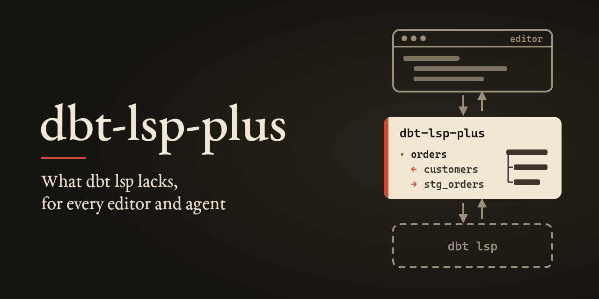

# dbt-lsp-plus

[](https://github.com/piotr-yuxuan/dbt-lsp-plus/actions/workflows/ci.yml)
[](https://github.com/piotr-yuxuan/dbt-lsp-plus/actions/workflows/cd.yml)
[](https://github.com/piotr-yuxuan/dbt-lsp-plus/actions/workflows/weekly.yml)
[](https://github.com/piotr-yuxuan/dbt-lsp-plus/releases/latest)
[](https://github.com/piotr-yuxuan/dbt-lsp-plus/blob/main/LICENSE)
[](https://github.com/piotr-yuxuan/dbt-lsp-plus/issues)
[](https://github.com/piotr-yuxuan/dbt-lsp-plus/blob/main/Cargo.toml)

A language server for dbt projects, for every editor and for agents,
from the project's files and your own `dbt parse`: the outline of a
model, every resource of a project as a workspace symbol, the call
hierarchy of models, sources, macros and functions, references and
renames of sources, definitions from YAML, definitions and references of
refs, macros and functions, a node's information on a hover, and the
last run's failures and the parse's errors as diagnostics.  It works
with dbt-oss and with dbt Labs' build of dbt 2 alike, runs no `dbt lsp`,
unlocks nothing that dbt gates behind an account, and does not ship dbt.
It is pre-release.



## Install and run

With Rust 1.89 or later and a C linker (or `nix develop`, which gives
Rust):

```
cargo install --locked --git https://github.com/piotr-yuxuan/dbt-lsp-plus --bin dbt-lsp-plus
```

or, for a branch or a local checkout, `cargo install --locked --path .
--bin dbt-lsp-plus` in a clone.

Then have your editor's LSP client start:

```
dbt-lsp-plus -- dbt lsp --project-dir /path/to/project
```

The server command after `--` names your dbt, by its words before `lsp`,
and the flags that its `dbt parse` takes; it never runs as such.  [Your
first session](docs/tutorials/first-session.md) walks through it on the
project of the tests, from Emacs.

Without `--project-dir`, the project is the client's folder when it holds
`dbt_project.yml`, else the one of the first file opened in a project, a
nested `dbt/` or a worktree; and `dbt` is the project's `.venv`'s, the
repository's or the main worktree's, else the one on `PATH`.  Outside a
dbt project it stays quiet.

For Claude Code, the repository is a plugin marketplace whose plugin
starts `dbt-lsp-plus` from `PATH` for `.sql`, `.yml` and `.yaml` files:

```
claude plugin marketplace add piotr-yuxuan/dbt-lsp-plus
claude plugin install dbt-lsp-plus@dbt-lsp-plus
```

[Use it with an agent](docs/how-to/use-with-an-agent.md) gives the
check in one call, who answers what, and what to do when nothing
answers.

From a shell, `dbt-lsp-plus doctor` says which project and dbt the server
would find and whether it would work, `dbt-lsp-plus select SELECTOR`
lists what a dbt selector selects, `dbt-lsp-plus node ID|PATH` gives
what dbt says of a node and the nodes that depend on it, and
`dbt-lsp-plus lineage ID` the nodes up and down from it;
`dbt-lsp-plus mcp` serves node and lineage to an MCP client ([the
subcommands](docs/reference/cli.md)).

## Documentation

- Tutorial: [Your first session](docs/tutorials/first-session.md)
- How-to: [Configure an editor](docs/how-to/configure-an-editor.md),
  [Use it with an agent](docs/how-to/use-with-an-agent.md),
  [Build and test](docs/how-to/build-and-test.md),
  [Troubleshoot](docs/how-to/troubleshoot.md)
- Reference: [The features](docs/reference/features.md), by LSP method,
  then [the configuration](docs/reference/features.md#configuration), every option;
  [The subcommands](docs/reference/cli.md), doctor, select, node, lineage and mcp;
  [The release pipeline](docs/reference/release-pipeline.md)
- Explanation: [The design](docs/explanation/design.md), how it reads a
  project and runs dbt, what dbt was observed to do, and what it would
  take to finish

## Licence

European Union Public Licence 1.2 ([`LICENSE`](LICENSE)) or GNU General
Public License 3.0 or later ([`COPYING`](COPYING)).
