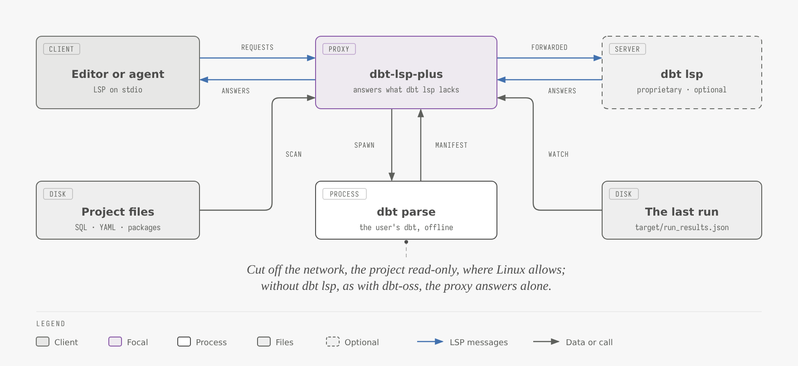

# Design of dbt-lsp-plus

dbt-lsp-plus sits between any LSP client and the proprietary `dbt lsp` of
dbt 2 (observed on 2.0.9).  It forwards every message unchanged and answers
itself the requests of the features that the server does not announce.
With a dbt that has no `lsp`, such as dbt-oss 2.0.11, it answers alone
(see "Standalone mode").  An
editor gets them through standard LSP, and so does an agent whose LSP tool
speaks definition, references, hover, document and workspace symbols and the
call hierarchy.

<picture>
  <source media="(prefers-color-scheme: dark)" srcset="../images/architecture-dark.png">
  
</picture>

## Boundary

- It uses only the server's interface (its messages, its announced
  capabilities and its custom command `dbt.listNodes`) and the user's own
  dbt CLI, whose `dbt parse` gives the resolved configuration that the
  server does not expose.
- It unlocks nothing that dbt gates behind an account.  Column-level
  features stay as the server gives them.
- It runs the `dbt` the user installed, and ships no part of it.  `dbt lsp`
  is optional: without it, the proxy answers alone from its scan and the
  user's `dbt parse`.
- Standard LSP is its only contract with an editor.  dbt-mode needs nothing
  specific to it: dbt-mode steps aside, feature by feature, for each
  capability the server announces, and keeps working without the proxy.

## Language: Rust

- One static binary that any editor or agent starts as a stdio server, with
  no runtime to install beside dbt.
- refmux (`circonomit/refmux`, Apache-2.0), the prior art, is Rust.  It runs
  one `dbt lsp` per project of a monorepo and adds no features.  The two
  compose as two processes, and code can move between them later.
- Python with pygls was set aside: pygls is a server framework that answers
  for itself, while a proxy must pass unknown methods, `dbt/*`
  notifications and the server's own requests byte for byte.  Go would serve
  as well as Rust; Rust won on refmux.

## Message flow

```
client ── stdin ──▶ dbt-lsp-plus ── stdin ──▶ dbt lsp
       ◀─ stdout ──              ◀─ stdout ──
```

One thread reads each input and sends whole frames to one event loop, which
owns all state and writes both outputs.

- Client to server: every frame is forwarded as it arrived, its bytes
  untouched, a body that is not JSON included.  The exceptions are the
  requests that the proxy answers itself, by their method's mode (see
  "Modes"), the client's answers to the proxy's own requests
  (`workspace/inlayHint/refresh`), and the client's `initialize`, from
  which the proxy removes its own `initializationOptions.dbtLspPlus`.
- Server to client: every frame is forwarded as it arrived, except:
  - the answer to `initialize`, to which the proxy adds the capabilities
    the server lacks (`documentSymbolProvider`, `workspaceSymbolProvider`,
    `callHierarchyProvider`), and whose `positionEncoding` it adopts
    (UTF-16 when absent, as with 2.0.9), and its `experimental.dbtLspPlus`
    and its command `dbt-lsp-plus.nodeInfo`;
  - the answer to a hover on a `ref` or a `source`, which gets a summary
    first (see "Node information and hover"), and to an inlay hint
    request, which gets the proxy's hints after the server's (see "Inlay
    hints");
  - in `merge`, the answer to a definition or references at a kind of
    target that the proxy claims, which gets the proxy's locations
    first, then the server's that match none of them (see "Modes");
  - the server's diagnostics of a file where the user's last run failed,
    which get the proxy's appended (see "The last run as diagnostics");
  - the answers to the proxy's own requests, which never reach the client.
- References and renames stay the server's, but on a source the server
  answers them with nothing: the proxy answers those requests itself, when
  the position is on a `source()` argument or on a source's or table's
  `name:` under `sources:`, references in any file under the root and a
  rename in a file the scan holds, and forwards every other one.
  Definitions likewise, where the document shows a target that the server
  answers with null (see "Navigation").  It says so under the
  standard `capabilities.experimental`, merged with the server's:
  `"dbtLspPlus": {"version": 2, "definition": {KIND: [PLACE, ...]},
  "references": {...}, "rename": {...}}` names, per request, the kinds of
  target it answers itself and the places of a request's position, `sql`
  (a `.sql` file), `yaml` (`.yml`, `.yaml`) or `python` (`.py`).  With a
  server or alone, the same kinds: those of definitions and references,
  with their places, in [Where dbt-lsp-plus answers definitions and
  references](../how-to/use-with-an-agent.md#where-dbt-lsp-plus-answers-definitions-and-references),
  which a unit test keeps equal to the flag; a rename's, which no test
  holds this page to, a source in SQL, YAML and Python and a CTE in
  SQL.  Until plan 037, `ref` in SQL and Python, `macro` and `function`
  were listed alone only.  A kind listed at a place is the proxy's at
  every position of that kind there, possibly null or `[]`, in any file
  under the root: references come from the scan whichever file asks,
  while a rename needs a file the scan holds, since it would leave the
  asking file as it is.  In `merge` with a backend, a definition or
  references there goes to the server too, and the server's locations
  that match none of the proxy's follow them (plan 042); in `plus`, and
  without a backend, a listed kind is never forwarded.  The kinds are by
  position, and the lists follow the modes (see "Modes"): `entry` is the
  `name:` of an entry, a function's under `functions:` included, `test`
  a generic test's name, `ref` in YAML a unit test's `model:` too,
  `function` either argument of `function()`, and `macro` the `ref` and
  `function` keywords themselves, which a project's macro may replace,
  and the name in the tag of a macro or a generic test.  dbt-mode steps
  aside for exactly those (its plan 014, agreed with plans 017 and 018),
  and reads version 2 only:
  it asks only for the kinds it knows, and maps only `.sql`, `.yml` and
  `.yaml` to places, so plan 018's `function` and `python` changed nothing
  for it.
- Who answers a method is its mode (see "Modes").  By default, the proxy
  takes the methods it adds only when the server does not announce them:
  dbt lsp 2.0.9 announces `documentSymbolProvider: false` but answers that
  request with a flat list of tokens, so the proxy takes it.  A later
  server that announces a feature gets its requests back.
- Request ids: the client's ids and the server's ids pass unchanged.  The
  proxy's own requests carry string ids `dbt-lsp-plus/N`, never one that a
  pending request of the client's carries; an answer is the proxy's own only
  when its id has that prefix and answers no request of the client's.  A
  request of the client's under the id of the proxy's listing in flight is
  refused with -32600, since the server would get two requests under one id.
- A panic while the proxy answers a request fails that request with -32603;
  the session goes on.  No input is known to cause one, so no test does.

### What a request gets

Every request the proxy answers itself, or answers for `dbt lsp`, gets
one value, the Answer (`src/answer.rs`, plan 044): found, a result as
its provider built it, an empty one included; empty, the method's
nothing, null or `[]` for a list, as its capability says, where the
request's position names nothing to look up; or unanswered, with each
provider's reason, the proxy's first.  A target that resolves to
nothing is found, a definition's null or references' `[]`; a position
that names no target is empty, for a definition, references and the
call hierarchy alike.  That holds for what the proxy's handlers answer,
alone and in `plus`; in `merge`, the proxy's nothing at a claimed
position is its empty part, which the client gets as empty when dbt
lsp gives none, whether the target resolved to nothing or not; and
nodeInfo by an id that names no node is empty.  LSP renders found and
empty alike; a rendering that tells them apart (plan 052) reads only
empty as nothing to look up, and those two cases with it.  An
unanswered request is error -32803 whose message is its reasons, joined
by `; `, as nodeInfo's has been since plan 038.  The protocol's own
errors (-32600, -32602, -32603) say that the request is wrong or that
the proxy broke, not who could not answer.  Before a project, every
request but `initialize` gets null, a result (see "Root").  The reasons
are one closed set, whose words live in one place, `Reason`'s
`Display`:

| Reason | Of | Message |
|---|---|---|
| `Unreadable` | the proxy | `no dbt project at <root>: its dbt_project.yml is missing, is not YAML, or names no project` |
| `Unindexed` | the proxy | `dbt parse has not finished: <why>`, why `it is running`, the parse's failure, or `waiting for dbt lsp to compile the project` |
| `Refused` | the proxy | a rename's refusal, as written |
| `Elsewhere` | the proxy | `<document> lies in the dbt project at <project>, and this session serves only the one at <root>` |
| `NotRunning` | dbt lsp | `dbt lsp is not running` |
| `Lost` | dbt lsp | `dbt lsp is lost for good: <why>`, as the give-up or the failed start said it |
| `Late` | dbt lsp | `dbt lsp did not answer within 2 s`, then `: it is compiling the project` while a compilation it started has not ended, nor gone 60 s with no end, said or not |
| `Failed` | dbt lsp | `dbt lsp failed: <its error's message>` |
| `Exited` | dbt lsp | `dbt lsp exited (<status>)` |

A root whose `dbt_project.yml` no longer reads (removed, broken
mid-edit, left without its `name`) is `Unreadable` for a definition or
references on a target, workspace symbols and the call hierarchy, where
no target stays empty; in `merge` in front of dbt lsp, such a
definition or references goes to dbt lsp, whose answer stands, and
when it gives none the proxy's reason comes first, then dbt lsp's:
`no dbt project at <root>: ...; dbt lsp failed: <its message>`.  Once
a parse has given an index, a hover and a nodeInfo at a `ref`, a
`source` or an entry's `name:` are `Unreadable` there too, alone and in
`plus`; in `merge` in front of dbt lsp, such a hover goes to dbt lsp,
whose answer stands, and when it gives none that reason comes first.
Inlay hints stay `[]`: their lookup reads the project.  Before it, as
elsewhere, nodeInfo fails with the parse's reason (`dbt parse has not
finished: ...`), and so does a hover at a `ref`, a `source` or an
entry's `name:` that dbt lsp leaves null.  The late log and a command's
failure, a result with `error` set, keep their own forms.

## Modes

Each method the proxy answers has a capability (`src/capability.rs`,
plan 042): one descriptor per method or command for clients, which says
who can answer it (its providers: the proxy, dbt lsp, dbt's CLI), how
their answers combine, the capability that announces it, the method
whose mode a follower takes, whether its nothing is `[]`, whether it
wants the parse's index, and the kinds of target the flag lists for it.
The capabilities announced, `experimental.dbtLspPlus`, the commands
listed and the methods that take a mode all come from that one table,
and the reference's table of who answers what is held to it by a unit
test.  Each method has a mode (`src/modes.rs`): `plus`, the
proxy alone, nothing sent to the server for it; `dbt`, the server alone,
answered byte for byte, the proxy computing nothing for it; `merge`, both,
as the proxy merges them.  The methods are `textDocument/documentSymbol`,
`workspace/symbol`, `textDocument/prepareCallHierarchy` (whose two
followers take its mode), `textDocument/foldingRange`,
`textDocument/documentHighlight`, `textDocument/selectionRange`,
`textDocument/hover`, `textDocument/inlayHint`, `textDocument/definition`,
`textDocument/references`, `textDocument/rename` and
`textDocument/publishDiagnostics`; any other method is `dbt`.  `ours`,
`plus`'s name before plan 037, is still read as `plus`, wherever a mode
is, and said once after `initialize`, in the warning that names refused
settings.  The shipped defaults:

| Methods | Shipped default |
|---|---|
| documentSymbol, workspace/symbol, the call hierarchy, folding, highlights, selection ranges | `plus` when the first server does not announce the capability, else `dbt` |
| hover, inlay hints, definition, references, rename, diagnostics | `merge` |

In `merge`, a hover gets the node's summary first and the server's text
after it under a line naming it, the hints come after the server's, the
diagnostics are per file the server's and the proxy's, definitions and
references are the union of both answers, the proxy's first, and a
rename goes by the kind of target (see "Navigation"), every row of
`experimental.dbtLspPlus` the proxy's; the methods the proxy adds are
its own, the server never asked.  In `plus`, a definition, references
or a rename is answered where the proxy claims the position, and with
null or `[]` elsewhere; a hover or hints are the proxy's part alone; diagnostics,
what the proxy publishes in `merge` without the server's part.

dbt lsp adds to the proxy's answer, but never holds it up.  A merged
request is a definition, references, a hover or inlay hints in `merge`
that goes to dbt lsp: with a backend, every definition and references,
a hover, hints.  Each remembers the proxy's part (its locations where
it claims the position, a summary, a docs block, a test's signature,
its hints); else its empty, null or `[]`, where it claims the position
and finds nothing, and for hints; else that it has nothing there.  The
client gets the part alone when dbt lsp has not answered within 300 ms
of the forwarding (`MERGE_DEADLINE`), and the empty, or why, within 2 s
(`NOTHING_DEADLINE`, plan 037), both in `src/capability.rs`, whose
`Capability::deadline` is the one place that a later plan with evidence
of a difference between methods would change; dbt lsp's late answer
is then dropped, logged once per method, deadline and what the client
got (`window/logMessage`, type 4, naming the deadline that passed and
whether the client got the proxy's answer or the reason), so that a 2 s
drop shows after a 300 ms one, and an error after an empty.  dbt lsp's error, its exit before it
answers, and no dbt lsp running when the request comes, give the
proxy's part or empty too; where the proxy has nothing, which only dbt
lsp could answer, the client gets error -32803 and why (plan 044, see
"What a request gets"): `dbt lsp did not answer within 2 s`, with `: it
is compiling the project` while a compilation that dbt lsp announced has
not ended, `dbt lsp failed: <its message>`, `dbt lsp exited (<status>)`
or `dbt lsp is not running`.  The proxy's empty at a claimed position
stays the answer, since its kinds are its own: an agent reading `dbt lsp
did not answer` on `ref('nowhere')` would wait for nothing; the hints'
empty too, as editors ask for hints at every scroll.  Over a project
that no longer reads, the proxy has no empty at a claimed position but
its reason, which comes before dbt lsp's.  Any other request
gets dbt lsp's error as it came, or -32803.  A hover on a node before
any index (see "What the client gets") gets dbt lsp's answer when it is
not null, else nodeInfo's reason, then, when dbt lsp gave none, `; ` and
why.  dbt lsp's own null or `[]` passes byte for byte; any other answer
passes as it came, or with the part merged.  The union (plan 042) reads
each of dbt lsp's entries by its shape first, a `uri` or `targetUri`
that is a string and a `range` or `targetSelectionRange` whose start
and end have a line and a character, a `LocationLink` written as a
`Location` of its target's selection, any other entry dropped (the
fake's echo is one), then by its path, as a client's URI is read and a
path outside the root with its links resolved; two locations match in
one file when the range of one holds the other's, and one whose path
cannot be read matches only itself.  When dbt lsp
adds nothing, the client gets the proxy's answer as it is, one
`Location` staying one.  Its cost: every definition and references at a
claimed position waits for dbt lsp, at most 300 ms where the proxy finds
a target and 2 s where it finds nothing (`ref('nowhere')`, `- unique`),
where `plus` answers at once, and each one does during a long
compilation.  Where dbt lsp's answer was seen it equals the proxy's or
lies within it, but for a versioned `ref` in SQL, which dbt lsp 2.0.9
reads without its version (see "Navigation"): its location there
follows the proxy's, and is wrong.  A user who finds dbt lsp wrong sets the method to `plus`.  The
narrower rule that plan 042 recorded for the owner would forward a
claimed position only where the proxy finds nothing.  Rename is no merged
request: dbt lsp computes a model's rename over the project, and a null
at a deadline would read as nothing to rename.  So dbt lsp's own answers
where the proxy has nothing (a CTE's or a column's definition, its hover
text before a parse) are lost only when they take more than 2 s, as
during a long compilation, and the client then reads why; a user who
wants them whatever their time sets the method to `dbt`.  dbt lsp 2.0.9
answered a hover in 107 ms during its
compilation on the fixture; on a project of 2,000 models from
`scripts/bench/generate.py`, the first hover after `didOpen` waited for
the whole compilation, 1.9 s; every other one took under 1 ms.  It ignores `$/cancelRequest`: a hover cancelled at once
during its compilation was answered with its result 110 ms later.

With the union (plan 042), a definition on `ref('stg_orders')` and on
`shop_utils.is_positive(...)` in `orders.sql`, and references on that
`ref`, get the proxy's answer in `merge`, observed on 2026-11-22 on the
fixture: dbt lsp 2.0.9's locations all match the proxy's, its reference
`'stg_orders'` (4:25-37, the quotes included) holding the proxy's name.
Once it has compiled, it answers a definition within 20 ms; but it took
1.2 s over the first references of the session, past the deadline, where
the proxy answers alone and logs it, then 2 ms over each later one.  One
check depends on those times: `navigation` asserts that no definition
was late, which holds while dbt lsp answers a definition within the
300 ms deadline.  The live test checks the answers, the proxy's
(`navigation`), and that dbt lsp is asked:
`the_union_in_front_of_the_real_dbt_lsp` records dbt lsp's input by
`tee` in the server command, and counts there one definition and one
references in `merge` at a claimed position.  The fake answers at once,
and its `hold` stands for a late server.

Plan 020 narrowed the roadmap's merge table.  Definition and references
stay per kind of target: the kinds the flag lists are the proxy's, dbt
lsp answering nothing there, with dbt lsp's other locations after them
in `merge` since plan 042.  Plan 020 left the definition and
references of `ref` in SQL and Python, `macro` and `function` to dbt lsp,
whose null on a package's `ref` or on a name two packages hold, and
references from the asking file only, passed as they came; with dbt lsp
running, an agent's definition on a `ref` came back null after 40 s.  Plan
037 lists them with a server too, on the corpus's evidence (see
"Conformance"), plan 021's live baseline, in which dbt lsp 2.0.9's
references on a `ref` left out the snapshot's, and those nulls, as the
owner decided on 2026-11-17, and announced the change to dbt-mode.  Plan
042 built the union of both answers at those kinds in `merge`, on the
owner's decision of 2026-11-17 ("`merge` is the union of both servers'
answers, `plus`'s first"), and announced it to dbt-mode first; the
provenance of a hover's part is its heading, and a location has none in
LSP.  The union of
workspace symbols and the call hierarchy by unique id waits for a server
that announces them, and the rows where the proxy has no answer
(completion, code lenses and actions, prepareRename, formatting,
signature help, semantic tokens) are dbt lsp's.

What `initialize` fixed stays for the session: the capabilities
announced, the flag and the table.  Who answers now follows the
Backend's life (see "State"): the session is alone when no dbt lsp
answers now nor will in the session, with `--backend never` or a dbt
without `lsp`, and from the moment a dbt lsp cannot start, exits before
it answers `initialize`, or is lost after a fourth crash (see
"Restart"; plan 043).  Alone, `merge` is the proxy alone (see
"Standalone mode"), and a method in `dbt` gets null or `[]`; a session
alone when `initialize` is answered does not announce such a method,
leaves its rows out of the flag, and warns once, naming it, after
`initialize` (plan 020, at dbt-mode's request: it reads announcements as
the truth).  While a restart is awaited or under way, the session stays
in front: the merged requests get the proxy's answer and the parse
follows whether a dbt lsp runs now (see "How the proxy runs it").
A method's mode is the user's for it, else the user's default, which
reaches only these methods, else the shipped one: the command line's
`--mode` and `--default-mode`, then `initializationOptions.dbtLspPlus`'s
`modes` and `defaultMode` over them, method by method.  The table is
fixed when `initialize` is answered, from the first server's
capabilities, and kept across restarts; capabilities and the flag follow
it.  `workspace/didChangeConfiguration` is forwarded but not read, since
the flag that dbt-mode reads at `initialize` could not follow a change:
a change applies at the next session.  A refused setting of
`initializationOptions` is ignored and shown once in a warning; a bad
option on the command line is a usage error.  dbt lsp 2.0.9 ignores
`initializationOptions`, whatever its shape (probed by plan 019); the
proxy removes its section all the same.

## Commands for clients

The proxy's commands for clients (`src/commands.rs`, plan 022) do what
dbt lsp's undocumented commands do, so that a client speaks only the
proxy's, with or without dbt lsp.  Their answers are dbt lsp 2.0.9's
shapes, the contract:

| Command | Arguments | Answer |
|---|---|---|
| `dbt-lsp-plus.compile` | `[URI]` | `{"file_uri": URI or null, "error": TEXT or null}` |
| `dbt-lsp-plus.show` | `[{"uri": URI, "limit": N}]` or `[{"inline": SQL, "limit": N}]` | `{"columns": [NAME] or null, "data": [{NAME: VALUE}] or null, "error": TEXT or null}` |
| `dbt-lsp-plus.nodes` | `[SELECTOR]`, dbt's syntax | `{"nodes": [NODE], "error": TEXT or null}`, each node with at least `unique_id`, `name`, `resource_type`, `package_name`, `original_file_path`, `depends_on.nodes` |

A show's limit is a positive integer, 10 when the client gives none, `dbt
show`'s documented default; a selection of no node is `{"nodes": [],
"error": "No nodes found"}`.  The first argument alone counts, as dbt lsp
reads its commands'.  The proxy's own failures hold these keys alone,
`error` set and the rest null (`[]` for nodes); arguments it cannot read
are -32602, a request after `shutdown` -32600.  Each request goes, as
`commands::route` decides:

- when a server runs whose answer to `initialize` listed the command's
  counterpart (`dbt.compileFile`, `dbt.show`, `dbt.listNodes`), to it,
  under the client's id, the command renamed, the arguments as they came
  but a show's limit; its answer reaches the client as it came, other keys
  included (`grain`, `error_kind`), its error too; a `nodes` counts as the
  client's listing, which the proxy never cancels; one in flight when dbt
  lsp dies is answered -32803, as any forwarded request;
- else `compile` and `nodes` by dbt's CLI, as the user runs dbt, and
  `show` answers `dbt-lsp-plus.show needs dbt lsp`: `dbt show` alone
  would reach the warehouse.  A server command with no `lsp`, from which
  a run's is made, makes the run answer an error.

"Else" is a session with no backend, a server that could not start, died
or is restarting, or one that did not list the counterpart.  `initialize`
announces `compile` and `nodes` always, as dbt's CLI can do them, and
`show` only when the server lists `dbt.show`; dbt lsp's own commands stay
listed and forwarded
as they come.  The code lens stays dbt lsp's (see below): a client
previews a CTE by `compile`, then `show` with `inline`.

The runs go one at a time, in the order asked, in `CACHE/run/`, apart
from the parse's target, its manifest removed before each run so that only
this run's counts, the compiled files of earlier runs kept for the
session; with the parse's flags, working directory, environment and guard
on packages; each killed past two minutes, at `exit`
and when the client closes; a run that ends with no answer, as on a panic,
is answered with a failure.  A compile runs `dbt compile
--select path:R --log-format json`, R the file's path from the root, the
root's own path never counted; a file outside the root, in a package, or
whose R holds a space or a comma (dbt's selector would split it) is
refused.  So is a compile where a package may have on-run hooks, which
`dbt compile` runs against the warehouse, even for one model (below):
`commands::hooked` reads the `dbt_project.yml` of the root, then of each
package under the install path that the guard takes (the server
command's `--packages-install-path`, else `DBT_PACKAGES_INSTALL_PATH`,
else the project's), by directory, as dbt loads them once the guard lets
it run, and names the first whose `on-run-start`, `on-run-end` or
top-level merge key, which may bring one, holds anything but a null, `""`
or `[]`, the forms seen harmless: `NAME has on-run hooks, which dbt
compile would run against the warehouse`.  A `dbt_project.yml` there that
repeats a key, of which dbt reads the last, refuses too, where no hook is
found, in words of its own: `FILE repeats a key, of which dbt reads the
last: a hook may hide there`; one that does not read refuses with the
guard's words.  Its answer is the `compiled_path` of the node of the root package
whose `original_file_path` is R, a test's never (as of a properties file),
in the manifest the run wrote, resolved from the working directory; none
answers dbt lsp's "Compiled file path not
found."; a failed run, dbt's first error (below).  `nodes` runs
`dbt list --select=SELECTOR --output json` with dbt's text log and
`--quiet`, and answers its JSON lines with a `unique_id`.  Either answers
dbt's first error, whatever its exit status, from the log it asks for: a
compile, the first error event of its JSON log; a list, the first
`[error]` line of its text log (`run::Output`), though dbt may write the
other kind (below); else, for a failed run, the first line that is none
of dbt's events, as a launcher's own, with how the run ended.  The
compiled file lives while the session does, as the cache.

### What dbt does for these commands, observed on 2026-11-17

Offline (`unshare -rn`), a scratch home, a copy of the fixture, both builds
alike unless said:

- dbt lsp 2.0.9: `dbt.compileFile [URI]` answers `{"error": null,
  "file_uri": "file:///…/target/compiled/shop/models/marts/orders.sql"}`,
  and on a file of no node `{"error": "Compiled file path not found.",
  "file_uri": null}`; `dbt.show` fails as `{"columns": null, "data": null,
  "error": TEXT}`, offline on the driver, with or without a limit;
  `dbt.listNodes ["+stg_orders+"]` answers `{"error": null, "error_kind":
  null, "grain": "project", "nodes": [...]}`, each node with its
  `unique_id`, `name`, `resource_type`, `package_name`,
  `original_file_path`, `depends_on.nodes` and `config` (`access`, `group`,
  `materialized`), and an empty selection `{"error": "No nodes found",
  "error_kind": "lineage_query_failed", "grain": "unknown", "nodes": [],
  "root_project": "shop"}`; `textDocument/codeLens` gives each CTE of a
  model `{"command": {"command": "dbt.previewCte", "title": "Preview CTE",
  "arguments": [PATH, {"name", "compiled_path", "compiled_start",
  "compiled_stop", "start", "stop", "start_location"}]}, "range"}`, PATH a
  path, not a URI.
- `dbt compile --select path:R`, with the proxy's flags and the working
  directory elsewhere, compiles
  statically and writes the node and the tests on it (`*.sql`,
  `*.macro_spans.json`); its manifest records the node's `compiled_path`
  relative to the working directory.  A snapshot's file is
  `compiled/shop/snapshots/orders_snapshot.sql/orders_snapshot.sql`; a
  version's, `compiled/shop/models/versioned/dim_v2.sql`; a seed has no
  `compiled_path`; a disabled model, a macro's file, a file of no node and
  a file under `dbt_packages/` select nothing (a warning, status 0).  A
  model with `run_query` under `execute`, and a Python model, try the
  driver and fail offline.
- `dbt list --select=S --output json --quiet` prints one JSON object per
  node; `*` gives models, seeds, snapshots, analyses and tests, no source,
  as `dbt.listNodes` does, `source:*` the sources, `+dim.v2+` the version
  alone, an empty selection nothing, a broken project `[error] [CODE]:
  MESSAGE`; with `--log-format json` every line is a log event.
- `dbt show` and `dbt build` fail offline: dbt fetches the DuckDB driver
  from its CDN when the home has none.  `dbt show --help` (2.0.11) gives
  `--limit` "[default: 10]".
- Observed on 2026-11-22, by plan 048's review, on dbt 2.0.9 and
  dbt-oss 2.0.11 alike, offline in a scratch home: a log may hold the
  kind its format does not name.  With `DBT_LOG_FORMAT=json` in its
  environment and no `--log-format`, `dbt list --select=S --output json`
  logs JSON events alone: with no `profiles.yml`, the error event
  `[error] [InvalidConfig (dbt1005)]: No profiles.yml found at …`, no
  other line, and status 1.  With `--log-format json`, a target path that
  dbt cannot create, its log path writable, gives the bare line `[error]
  [IoError (dbt1001)]: Failed to create output directory: …`, no event,
  and status 1; a project directory that cannot be canonicalised does
  the same.  A list answers
  the first as how dbt ended, and a compile the second as a launcher's
  line with how dbt ended, until one rule reads both kinds (plan 071, once
  dbt's output is read apart from its log).
- Observed on 2026-11-18, offline, on both builds: `dbt compile` stopped
  at an `on-run-start` or `on-run-end` hook given as a string, a list, a
  package's, even `"{{ '' }}"` (dbt1308, the driver), and did nothing
  more for `[]`, `""` or no value.  Observed on 2026-11-22 on a
  Snowflake trial account with dbt 2.0.9: `dbt compile`, also with
  `--select` of one model, ran the `on-run-start` and `on-run-end` hooks
  against the warehouse; `dbt parse` and `dbt list` sent no query.
  Observed on 2026-11-23, by plan 056's review, with dbt-oss 2.0.11
  offline: `on-run-end: ~` and `on-run-start: null` ran nothing, as no
  value does; a package with an `on-run-start` hook under the server
  command's `--packages-install-path` made `dbt compile` start the hook
  (dbt1308, `in <RUN_OPERATION>`).

## Root

The project directory, the root, comes by one of three routes, the first
that applies:

- **given**: the server command's `--project-dir` (`--project-dir X` or
  `--project-dir=X`), so that the proxy reads the project the server runs
  on.  Everything starts with the process, as before plan 036: the probe
  of `lsp` and `dbt lsp`, in the proxy's working directory,
  with the command as written, and nothing more is said.  dbt-mode takes
  this route, always.
- **the folder**: else the client's first workspace folder, or `rootUri`,
  when it holds a `dbt_project.yml`.  What the given route starts with
  the process starts when the client's `initialize` comes, before it is
  forwarded: the dbt (below), its probe, `dbt lsp`.
- **a document**: else the first document opened that lies in a project,
  from its path as spelt: the nearest directory above it holding
  `dbt_project.yml` that lies in no package of a directory above it
  holding one (`locate::project_of`).  A directory lies in a package of
  one above when it is under that one's install path, as dbt takes it, or
  in one of its local packages, as spelt or links resolved, as a hub
  package's own `integration_tests` project does; the walk then goes on
  from the next one above.  A project whose `dbt_project.yml` does not
  read has no packages.  No walk stops at git's
  top level: a worktree in a checkout is no package of it.  dbt-mode's
  walk (`dbt-project.el`) also skips `dbt_internal_packages` and reads the
  install path from the project alone.  The proxy answers `initialize`
  before any document comes (Claude Code opens the first one right after
  `initialized`), so such a session is alone for its life: its answer is
  the alone one, without the alone message, and `dbt lsp` never starts
  (no plan starts it: the proxy role goes with plan 075).  At that
  document, before it is tracked: the root, the dbt, the first scan, the watcher of runs, the watcher of files when the client
  lets the proxy register it, and the line; then the parse, as alone.

The working directory no longer names the project.  Before a project, and
for ever when no document lies in one, the proxy is quiet: no process (no
probe, no git, no dbt), no polling, no watcher, nothing on
its standard error, no message but a refused setting's at `initialize`,
and every request but `initialize` gets null, valid for each method the
proxy announces and each one an agent was seen to send.

Once there is a project, a document lies in it when under the root or
in one of its packages, installed or local, as spelt or links resolved,
and in another project when the walk up from it finds one
(`locate::elsewhere`).  A request on a document of another project, of a
method that reads the project and names its document by
`textDocument.uri` (a hover, a definition, references,
`prepareCallHierarchy`), fails with `<document> lies in the dbt project
at <project>, and this session serves only the one at <root>`, alone and
in `plus`, and a nodeInfo at a position there, which has no mode, fails
with it too, before or after the first parse; in `merge` in front of dbt
lsp, a hover, a definition or
references goes to dbt lsp, whose answer stands, and when it gives none
that reason comes first, while `prepareCallHierarchy`, the proxy's own
in `merge` too, fails at once.  Inlay hints there are `[]` alone and in
`plus`, and dbt lsp's answer as it came in `merge` (null on a macro or
properties file: see "Inlay hints"); a method set to `dbt` goes to dbt
lsp.  The rest is answered as
before: the methods of the document's own text, a rename, which there
is a CTE's alone, a document in no project, every request while the
root's `dbt_project.yml` does not read, and a project nested under the
root, which is the root's: one session serves one project (plan 049).

On the folder's route and a document's, when the server command's first
word is `dbt` (the default `dbt lsp` included), the dbt is the project's
(`locate::dbt`): the first of `<project>/.venv/bin/dbt`,
`<top>/.venv/bin/dbt`, `<main>/<project from top>/.venv/bin/dbt` and
`<main>/.venv/bin/dbt`, without repeats, that is a file and answers `lsp
--help`, in the project, as a dbt 2 does, with `lsp` (status 0) or without
(dbt-oss's status 2 and "unrecognized subcommand 'lsp'"); `<top>` and
`<main>` come from one `git rev-parse --show-toplevel --git-common-dir`
in the project, without `GIT_DIR` or `GIT_WORK_TREE`, `<main>` the common
directory's parent when that is named `.git`; the common directory, which
git may give relative to where it ran, is read from the project as
written, each `..` dropping the component before it, so that a `.git`
reached through a link keeps its name; with no `--path-format`, which git
before 2.31 prints back as a word.  A file that answers otherwise (dbt-core 1.x's "No such command
'lsp'", one that cannot run, one past the deadline) is skipped and named.
Else `dbt` stays, for `PATH`, probed as on the given route (on the
folder's route only, since a document's starts no server).  Any other
first word (a path, `uvx`, `dbt-2.0.9`) is the user's, kept.  Only `.venv`
is looked at: no other environment, no `Scripts\dbt.exe`.

The line: once, on the standard error and as one `window/logMessage`
(type 3) once the client can take it, `dbt-lsp-plus: project <root>, dbt
<path> (<where>)`, `<where>` one of "the project's .venv", "the
repository's .venv", "the main worktree's project .venv", "the main
worktree's .venv", "PATH" (named by the first `dbt` on it) and "the server
command", then each place skipped and why, then why the proxy is alone,
when it is: "the backend is never", "dbt lsp is not started for a project
found from a file" or "it has no lsp".  It replaces the alone message of
the given route; it is not an interface (plan 039's `doctor` will be).
Claude Code shows it only in its debug log.

On those two routes, dbt's processes run in the root: `dbt lsp`, the
probes, the parse and the runs of the commands for clients, so that a
`profiles.yml` beside the project is found as under lsp-mode, which starts
the server there; a YAML error's file and a compile's path are read from
there too.  The proxy's own working directory does not change, and what
the server command names from it keeps naming it: a first word that is a
relative path and a relative `--profiles-dir` are made absolute against
it first (`config::anchored`); a relative `--packages-install-path` is
the project's, for dbt as for the proxy.

The URIs the proxy returns are built on the root, so the root keeps the
spelling the user or the client gave it:
- `--project-dir` is made absolute as spelt, links unresolved, each `..`
  dropping the component before it; it is resolved only when that would name
  another directory, through a link before a `..`;
- when the client's folder is the same directory under another spelling (a
  symbolic link), the client's spelling wins.

A document under the root as spelt keeps its path, links within the project
included, since the scan walks them so.  A document reached through another
spelling of its directory is mapped onto the root by that directory's
resolved path.

### What Claude Code does with a language server, observed on 2.1.317

A logging language server in a plugin, and Claude Code driven by a local
stand-in for the Messages API that plays a script of tool calls, in a
scratch home and configuration, on Linux, from the command line: at a
repository's root whose dbt project is in `dbt/`, in a linked worktree,
in `dbt/models`, with no capability announced, an `Edit` first, and the
proxy 0.1.5 in front of dbt 2.0.9.  What was read from the 2.1.317
bundle's code rather than seen in a session says "(bundle)".

- A server starts late: nothing starts with the session.  The first call
  of the LSP tool on a file whose extension the plugin maps starts it, and
  so does the first `Edit` of such a file; `Read` does not.  The LSP tool
  is deferred: an agent loads it with ToolSearch first.
- Its process runs in the session's directory (or a host's
  `projectConfigRoot`, or `.lsp.json`'s `workspaceFolder`, when set
  (bundle)); `${CLAUDE_PLUGIN_ROOT}` and `${CLAUDE_PROJECT_DIR}` are
  expanded in `args`; its environment is Claude Code's, plus
  `CLAUDE_PROJECT_DIR` (the session's directory), `CLAUDE_PLUGIN_ROOT` and
  `CLAUDE_PLUGIN_DATA`.  The desktop app's was not observed.
- `initialize` names one workspace folder, `rootUri` and `rootPath`, all
  the session's directory: a repository's root, a worktree's root or
  `dbt/models`, never the nested project.  `initializationOptions` is `{}`.
  The client offers `didSave`, hover in markdown, definition links,
  hierarchical document symbols, the call hierarchy and
  `positionEncodings: ["utf-16"]`; `workspace.workspaceFolders` false,
  `didChangeWatchedFiles` without dynamic registration; no rename, inlay
  hints, code lens, code actions, completion, `executeCommand` or
  `window.workDoneProgress`.
- The first `didOpen` comes at once: `initialized`, the `didOpen` of the
  file that started the server, then its request, within a millisecond of
  the answer to `initialize`.  Each new file is opened before its request.
  The first document can lie outside every dbt project: an `Edit` of a
  repository's `ci.yml` opened it before any model.
- Announced capabilities are not read: to a server that announced none,
  it sent hover, `workspace/symbol`, `textDocument/implementation` and
  `prepareCallHierarchy`.
- What it drops: `window/showMessage` and `window/logMessage` leave no
  trace; a line on the server's standard error goes to the debug log,
  written only with `--debug` or `--debug-file`, as `[LSP SERVER
  plugin:<plugin>:<server>] <line>`; `client/registerCapability` is
  answered null and ignored (bundle); `didChangeWatchedFiles` never comes.
- An `Edit` of a file not yet open sends `didOpen` with the new text and
  no `didSave`; of an open file, `didChange` with the whole text, then
  `didSave`.  Past 50 open files it closes the oldest (bundle).
- References outside the session's directory, or under a path git
  ignores, reach the agent; a null reads "No symbols found", "No
  definition found".  A request waits 60 s by default (`requestTimeout`);
  a crashed server is restarted up to three times (bundle).
- `.lsp.json` (bundle): `command` (no space unless absolute), `args`,
  `extensionToLanguage` (required), `transport`, `env`,
  `initializationOptions`, `settings`, `workspaceFolder`,
  `startupTimeout`, `shutdownTimeout`, `requestTimeout`, `restartOnCrash`,
  `maxRestarts`, `diagnostics` (default true: diagnostics pushed into the
  agent's context after its edits).  An extension maps to one server: a
  second plugin claiming `.yml` is not used for it.  With `--plugin-dir`, a
  directory with `.lsp.json` at its top is one plugin (observed).
- The proxy 0.1.5 in front of dbt 2.0.9 offline, the session in the
  fixture's folder: a hover on `ref('stg_orders')` answered dbt lsp's
  parents and children, then, once the parse had run, the proxy's summary
  above them; the definition, one reference, eight workspace symbols.
  Claude Code answered dbt lsp's `window/workDoneProgress/create`,
  `workspace/configuration` and refresh requests, and took 143 empty sets
  of diagnostics.
- The LSP tool's `line` and `character` are 1-based, sent as `line - 1`
  and `character - 1`: line 1, column 1 is position 0:0 (bundle).
- An error answer reaches the agent as `Error performing <operation>:
  LSP request '<method>' failed for server 'plugin:<plugin>:<server>':
  <message>`: the message whole, not its code nor its `data` (bundle).
- ContentModified (-32801) is retried up to three times, after 500, 1,000
  and 2,000 ms, then reported as any error; no other code is retried
  (bundle).
- A null hover reads "No hover information available", with "the cursor
  is not on a symbol" or "the LSP server has not fully indexed the file"
  as its causes; a null definition, empty references and empty workspace
  symbols read alike, each naming indexing as a possible cause (bundle).
- A workspace symbol shows as `<name> (<Kind>) - Line <n> in
  <containerName>`, grouped by file, its `data` unread; a call hierarchy
  item as `<name> (<Kind>) - <file>:<line> [<detail>]`; a document symbol
  as `<name> (<Kind>) <detail> - Line <n>`.  A hover's contents are
  joined, prefixed with "Hover info at L:C:" only when it has a `range`
  (bundle).

So a plugin cannot name the project, and when the client's folder holds
none, the proxy answers `initialize` before it can know it.

### dbt lsp under a parent `rootUri`, observed on 2.0.9

Started in a repository's root, the fixture copied to `dbt/`, with
`rootUri` the repository's root: with `--project-dir dbt` and without it,
dbt lsp compiled `dbt/` on the `didOpen` of `dbt/models/marts/orders.sql`,
answered the definition of `ref('stg_orders')` with its file and its hover
with the parents and children.  `dbt lsp --help` exits 0 on 2.0.9;
dbt-oss 2.0.11's exits 2 with "unrecognized subcommand 'lsp'".

## State

- Open documents: the text of each, kept from `didOpen` and the incremental
  `didChange` (UTF-16, UTF-8 or UTF-32 units), so that the outline follows
  unsaved edits.
- The project: found on each request from `dbt_project.yml`, its resource
  paths, through symbolic links, the packages under
  `packages-install-path`, and the `local:` packages of `packages.yml` and
  `dependencies.yml` not installed there yet, as dbt reads them, with the
  open texts winning over the files on disk.  A file whose name starts
  with a dot is left out, as dbt leaves it out, but not the files of a
  directory whose name does.  Seeds are found but not read.  This finds:
  - models, Python models among them, seeds, snapshots, analyses,
    singular tests, and functions, each `.sql` or `.py` file under
    `function-paths`;
  - snapshots declared in YAML: a `snapshots:` entry with `relation:`,
    its calls those of its relation; one without patches a snapshot of
    SQL, or names nothing;
  - each version of a versioned model, at its file as dbt finds it: the
    version's `defined_in`, else `<name>_v<N>`, anywhere under the model
    paths, and the latest's `<name>` too unless a `defined_in` names it.
    The latest is `latest_version`, else the highest version: as numbers
    when all are numbers, else all as text, as dbt orders them;
  - macros, generic tests and docs blocks;
  - source tables, from the YAML of every resource path, parsed with the
    place of each scalar as written and where each mapping ends;
  - the `ref`, `source`, `function`, `adapter.dispatch` and macro calls
    inside the Jinja tags of each body.  A tag inside a SQL comment counts, since Jinja
    renders it; a `ref(` in prose does not.
- The scan of SQL and Jinja is lexical, not a parser:
  - Jinja tags end at their first closer outside strings and nested braces,
    and the content of a raw block holds none;
  - CTEs are found after `with` or a comma, outside Jinja, SQL comments and
    strings, so a CTE that Jinja generates is not one but those after it
    are;
  - names may hold any letter.
- The scan is kept between requests by the Workspace
  (`src/workspace.rs`), the core's state of the session's project beside
  the last parse's index, the parse under way and the call hierarchy's
  graph, which speaks no protocol: the LSP front end keeps the open
  documents, the URIs and the positions, and hands it the open texts.  It
  lives on the event loop, which alone owns it (`src/cache.rs`).  A
  request that needs the project walks the resource paths again and
  reads each file's metadata before its content:
  its modification and change times, size, inode and device.  A file whose
  metadata stays keeps its text and what that text alone gives (blocks,
  calls, source tables); any other is read again, and a file gone is
  dropped.  A file that is not UTF-8, such as a `Thumbs.db`, counts as
  empty; one that cannot be read counts as empty too, and is tried again
  at the next request.  A seed is found but never read, open or not.  An
  open document is known by the proxy's count of its edits,
  bumped at each open and change, since a client's version starts again
  at each open.  No file event is needed: a client may watch nothing.
  - When no file changed, nor any package's name and paths, which each
    `dbt_project.yml` gives and the walk reads again, the request shares
    the last project.  Otherwise the project is assembled again from the
    kept files, since a file's resources depend on its package and
    layout.  The call hierarchy's graph is kept while the project, the
    server's nodes and the last parse's index stay.
  - `initialize` starts a thread that reads every file once, whose files
    the cache takes once it is done.  Nothing waits for it: a request
    that comes before reads the files itself.
  - Measured on synthetic projects (`scripts/bench/`) of 3,000 and 6,000
    models with 15 YAML columns each (12.8 and 22.8 MB), on tmpfs, in a
    release build: a workspace symbol, definition, references, rename or
    call hierarchy request answers in 15 to 23 ms and 30 to 40 ms with
    nothing changed, but the references of a macro that every model
    calls (see "Known limitations"), and within 0.20 and 0.31 s as the
    first request after the save of a model, of the largest properties
    file or of `dbt_project.yml`.  Each took 0.3 to 1.7 s without the
    cache.  The proxy then holds 79 and 142 MB.  These figures predate
    plan 050: a definition, references and an alone call hierarchy ask
    for the index, and so walk once more when it is fresh and a parse has
    started, to compare the files on disk with that parse's stamp
    (`Workspace::notice`), and each parse's start walks once more for its
    stamp (`cache::disk`); unmeasured.
- The graph: once the server has listed the graph, the dependencies of each
  node it listed are its own, since only dbt resolves `ref(var('x'))`; until
  then, and for the nodes it did not list, they come from the scan.  The
  server lists no macros, so the edges to and from macros always come from
  the scan.  The scan looks a call up as navigation does (see
  "Navigation"), by the one rule of `navigation::Lookup`: a ref or a source
  in the caller's package, the root project, then any package, the root
  first under the lookup flag, every candidate where dbt fails on two
  packages (dbt1005) (in a macro, dbt looks in the calling node's package:
  see "Known limitations"), and an unqualified macro in the caller's
  package and the root project only, as dbt does: another package's macros
  need its name.  Once a parse has given an index, the scan's calls are
  looked up with it: a node or a source table that the last manifest
  disables is no call's target, a name the parse knows leads to its
  nodes, a call keeps its site on the edge that the listing or the
  manifest gives, and a target no file holds is left out.
  A dispatch names every
  `*__name` implementation of its package.  A listing that fails keeps the
  graph it had.  An empty `*` listing counts as a failure, since the scan
  found resources; an empty `source:*` does not.  After a crash, the scan
  gives the whole graph again, until a restarted server lists it; once
  dbt lsp is lost for good, the last parse's, as alone.
- A source that `overrides` a package's source is that package's source:
  dbt-core patches it, so the proxy places its tables in the package
  (dbt 2 does not: see "Known limitations").
- Text read from disk loses its byte order mark, as an editor's document
  does, so that positions on its first line match.
- The Backend, the dbt lsp process behind the session (`src/proxy.rs`),
  is one value whose life is one of five: not started, with why (the
  backend is never, a dbt without `lsp`, a project found from a file, no
  project yet); running; waiting for a restart; starting again, until the
  new process answers its `initialize`; lost, with why.  Beside its life
  it keeps what it told the client, across lives: the registrations the
  client holds, the progress tokens it began and has not ended, the
  commands it listed, the failures of compilations said and whether a
  stall was.  A running process owns the proxy's listings and its
  compilation's deadline, which end with it.  It is killed and reaped in
  one place (`Server::reap`).  A restart is sent again the client's
  `initialize` parameters and each open document's URI, language and last
  version, as the client sent them.

### What `dbt.listNodes` does, observed on 2.0.9

- It reads only its first argument.  `*` lists models, seeds, snapshots,
  analyses and tests, but no sources, which need `source:*`.  No selector
  lists macros, and `depends_on` names nodes only.
- A second `dbt.listNodes` in flight cancels the first: the first is
  answered `{"error": "Operation cancelled", "nodes": []}`.
- Each one makes the server compile, and `dbt/lspCompileComplete` follows
  its answer.  The first prototype listed on that notification, which made
  a loop: 565 compilations in two minutes.
- The server compiles nothing after `initialized` until a document opens or
  a request comes.
- It writes under its `--project-dir` only `logs/dbt-lsp.log`, from its
  start, and `target/**` at each compilation (compiled SQL, the seeds'
  parquet, `private/metadata/compile/schemas/N.parquet` created and
  deleted), whatever its `--target-path`, `--log-path`, `DBT_TARGET_PATH`
  and `DBT_LOG_PATH` say (probed once by plan 025's critic; no test
  checks it); `dbt_project.yml` refuses `log-path` as it refuses
  `target-path` (dbt1005).  Right after `initialized` it registers
  the watcher `{"watchers": [{"globPattern": "**/*"}]}`.  A client that
  honours it and sends an event for each write made the proxy, before it
  filtered them, list 1249 times a minute on the fixture; ignoring
  `target/` alone, 1381; `logs/` alone, 182.  The server itself compiles
  on no event that names only its output.

So the proxy lists `*` and then `source:*`, one after the other.  It lists
on the client's signals only:
- the first `didOpen`, and no later one, even when that listing failed:
  each listing makes dbt lsp compile, if only incrementally where nothing
  changed (see "What a compilation does, observed on 2.0.9"), and an
  editor that restores a session opens many documents; the next change
  lists again;
- `didSave`;
- `workspace/didChangeWatchedFiles`, and files created, renamed or deleted;
  but not a watched change whose every file is a `file:` URI in dbt's own
  output, `target` and `logs` under the root, the directories and all
  below them, as spelt or as resolved (lsp-mode reports a linked
  directory's files at their resolved path): such an event changes no
  state of the proxy (no listing, the parse not marked stale), and
  reaches the server as it came.

The server gets the client's change before the listing it prompts.  The
proxy never lists while a `dbt.listNodes` of the client's is pending, nor
sends the second selector then, nor anything after `shutdown`.  It retries a
cancelled listing at most three times, and abandons one unanswered after two
minutes, on time, even when the client is quiet; no test waits the two
minutes, so only a unit test of the abandonment covers it.

### What a compilation does, observed on 2.0.9

Probed for plan 035 on 2026-11-22 with dbt 2.0.9, the proprietary build,
by a client of its own that plays an editor's phases on scratch copies:
the fixture with the live test's `LIVE_MODELS`, whose unknown doc is a
standing warning; the projects of `scripts/bench/generate.py` with 1,000
and 3,000 models and 15 columns each, on DuckDB, which report 20 errors
of their own at every compilation (their snapshots lack a `strategy`,
dbt1005); the fixture with its package as a `local:` one; and three
more after it: S1, the fixture whose `profiles.yml` has `path: "{{
env_var('DBT_LSP_PLUS_PROBE_MISSING') }}"`; S2, the fixture whose
`dbt_project.yml` ends with `on-run-start: ["select * from
no_such_table"]`; S3, a model's watched change, then the proxy's two
listings, `*` and on its answer `source:*`, then the same after a
`didSave` and its watched event.  Durations are the completions' own
`duration_ms`.

- O1: `dbt.listNodes ["* source:*"]` answers `{"error": "No nodes
  found", "nodes": []}`: one selector a request.
- O2: a listing's compilation with nothing changed is incremental and
  short: 13 to 20 ms on the fixture, 28 to 37 ms on 1,000 models, 49 to
  63 ms on 3,000; `*` then `source:*` makes two foreground compilations
  and one background compilation after both.
- O3: a compilation follows the first `didOpen`, each `didSave`, each
  listing, and a watched change of a model with no `didSave` (6 s after
  a save, one foreground and one background); a `didSave` and its
  watched event back to back make one, of each.  Every completion's
  `cause` is `didSave`, whatever the trigger.
- O4: a start carries `adapter_type`, `adapter_unique_id`, `cause`,
  `compile_type` (`incremental` in the foreground, `full` in the
  background), `dbt_version` and `project_id` (the first start's adapter
  and ids null); a completion those and `duration_ms`, `errors` and
  `models_count`.
- O5: `errors` holds objects `{"code", "message", "severity"}`,
  `severity` `Error` or `Warning`, the message on several lines, its
  place `\n(in models/marts/orders.sql:24:9)\n  --> models/marts/orders.sql:24:9`
  or only `\n  --> models/marts/customers.sql:3:10`.  dbt lsp publishes
  each entry as a diagnostic on its file, severity 1 for an error and 2
  for a warning, source `dbt`.  With a Jinja error in a model, or a
  missing ref, `models_count` stays 6: the other models compiled.
- O6: the same state compiled again gives the same entries in another
  order; a background completion lacked an entry of its foreground's
  (dbt1048).
- O7: the first compilation takes 106 ms on the fixture, 997 ms on 1,000
  models, 2,726 ms on 3,000; a background full compilation 17 to 101 ms,
  171 to 512 ms, 479 to 1,471 ms; the background start comes about 1.1 s
  after the last foreground completion.
- O8: each compilation's `$/progress` begin carries `"percentage": 0`,
  `"title": ""` and the message `Analyzing`, or `Background Analyzing`;
  its reports carry a `percentage` counting up, one a file (`Loading:
  profiles.yml`, `Parsing: PATH`, `Rendering: PATH`, `Rendered: PATH`):
  1,147 on the first compilation of 1,000 models.  lsp-mode shows that
  percentage.
- O9: a listing gets a progress of its own, `<uuid>:dbt/progress/listNodes`,
  title `Computing Lineage`, message `Waiting for compilation to
  complete...`, cancellable, ended with its compilation; a references
  request gets one too, `<uuid>:dbt/progress/references`, `Finding All
  References`, the same message, ended at once after its answer whether a
  compilation runs or not.  That message is no sign of a wait.
- O10: the first compilation writes `package-lock.yml` and
  `dbt_packages/shop_utils`, a link to the local package; the listings
  after it write nothing outside `target/` and `logs/`.
- O11: each compilation adds 84 to 175 lines to `logs/dbt-lsp.log`: a
  header, `Processed: 6 models | 1 snapshot | 2 seeds | 1 analysis`,
  `Summary: 10 total | 10 success`, `Cached model count updated: 6 models
  (accurate)`, and on failure `Finished 'compile' with 1 warning and 2
  errors`.
- O12: `lsp --help` lists, among others, `--threads`,
  `--static-analysis`, `--defer`, `--no-defer`, `--state`,
  `--favor-state`, `--dirty`, `--compute`, `--select`, `--exclude`,
  `--selector`, `--resource-type`, `--log-level`, `--log-level-file`,
  `--lint-enabled`, `--no-manage-state`, `--no-version-check`,
  `--write-catalog` and `--generate-info-schema`.  The proxy passes none
  of them: it runs the user's server command as given.
- O13: `dbt/lspBackgroundCompileStart` then
  `dbt/lspBackgroundCompileComplete` follow the foreground compilations,
  one pair for several in quick succession, with the same keys, the
  completion's `errors` its own.
- O14: `errors` is a list, warnings included: the fixture's unknown doc
  is in it, `Warning`, and `models_count` is 6 with errors as with none.
- S1: with the profile's `env_var` missing, the first `didOpen` brings no
  compilation, no progress and no diagnostic; each listing a foreground
  start, then within 1 ms a completion whose `models_count` is null and
  whose one entry is `{"code": "1005", "message": "[InvalidConfig
  (dbt1005)]: Jinja render error: invalid operation: 'env_var':
  environment variable 'DBT_LSP_PLUS_PROBE_MISSING' not found\n(in
  :1:1)", "severity": "Error"}`, then a background completion alone, no
  start, `incremental`, the same; the listing is answered `Compilation
  failed`, and the diagnostic lands on `dbt_project.yml`.
- S2: with a hook that fails, the first `didOpen` brings a foreground
  start, a completion after 2,353 ms whose `models_count` is null and
  whose one entry is `[DbDriverFailed (dbt1308)]: Catalog Error: Table
  with name no_such_table does not exist! ... (in <RUN_OPERATION>:1:9)`,
  `Error`, then a background completion alone, the same; the diagnostic
  lands on `<RUN_OPERATION>`, a file that does not exist.
- S3: a model's watched change, then the proxy's two listings: three
  foreground compilations (dbt lsp's own, 93 and 94 ms, the listings'
  13 to 22 ms) and one background pair after them, about 1.1 s after the
  last; the same after a `didSave` and its watched event.
- S4, found by plan 035's review on the generated 1,000 models,
  reproduced three times: a `didOpen`, at once `dbt.listNodes ["*"]`,
  then 0.3 s later a `didChange`, a `didSave` and its watched event.  The
  listing is answered `Operation cancelled` at 0.365 s; the first
  compilation completes then, `incremental`, after 344 ms, with
  `models_count` null and `errors` `[]`, followed by a background
  completion alone, the same; a new start comes at once, its completion
  1 s later with `models_count` 1,050, then a full background pair.  A
  second `dbt.listNodes` 0.3 s into the first compilation does the same.
  A later compilation cut short by a save, a background one cut short,
  and a cancelled listing past the first compilation all kept
  `models_count` set.
- S5, found by plan 035's second review on the fixture, dbt lsp alone:
  after the first compilation, one watched event alone every 4 s, of
  `models/staging/_sources.yml` (type 2), `macros/money.sql` (2), a new
  model (1, `models_count` 7), its deletion (3, 6 again),
  `dbt_project.yml` (2) and `models/marts/orders.sql` (2): each made one
  foreground compilation, 83 to 91 ms, then a full background pair about
  1.1 s later.

So a compilation that compiled nothing reports `models_count` null and
an entry of severity `Error` (S1, S2); `models_count` null with no error
is a first compilation cut short, which the next one follows (S4); an
error in a model leaves it a count.

The fake (`tests/support/fake_dbt_lsp.rs`) compiles on the triggers
seen: the first `didOpen`, each `didSave`, each listing, and a watched
event with a change of any type under its root outside `target/` and
`logs/`, as 2.0.9 compiled on a model changed, created or deleted, a
properties file, a macro and `dbt_project.yml` (O3, S5); other files,
such as under `dbt_packages/` or `.git/`, no probe tried.  Its window of 1 s, within which a watched
event of the file a `didSave` named compiles nothing more, is its own,
chosen between O3's two cases (back to back, one compilation; 6 s
apart, two), and no live test checks it.  Its frames carry O4's keys,
and its background pair comes at once after each foreground
compilation, where 2.0.9 sends it about 1.1 s later and joins several,
so that no test waits.  Where its completion's `models_count` is null,
the background completion comes alone and a listing is answered
`{"error": "Compilation failed", "error_kind": "compilation_failed",
...}`, as in S1 and S2; it does not model S4.  The live test checks
O3's and O13's shape in `watcher`, O4's keys and O8's percentage in
`recorded_observations`.

## Sources

- References of a source table, or of a whole source: every `source()`
  call that names it, in SQL inside Jinja tags, in YAML without them (a
  relationships test's `to:`), in each package's `dbt_project.yml` (vars,
  hooks) and in a Python model (`dbt.source()`); the key that configures it
  under `sources:` in the root `dbt_project.yml`; and its declarations when
  the client asks.  A call whose argument is an expression, as in
  `source('raw', 'events' ~ var('suffix'))`, names no table.
- References come from the scan whichever file under the root asks, the
  asking file left out when the scan does not hold it, as a file not saved
  yet or one outside the resource paths.  A rename is answered only on a
  file the scan holds, which it then edits; elsewhere it goes to the
  server.
- An open document is named by the URI the client opened it under, and its
  ranges are those of its open text.
- A rename keeps the relation in the warehouse.  dbt takes a table's
  identifier from its name, and a source's schema from its name, unless they
  are set: `dbt parse` gives `events.page_views`, declared without `schema:`,
  the schema `events`.  So renaming a table without `identifier:` inserts
  `identifier: <old>` after its `name:` line, at the key's indentation and
  with the line's own line break, and renaming a source without `schema:`
  inserts `schema: <old>`.  The live test renames `events.page_views` and
  checks that dbt still compiles the model that selects from it to
  `page_views`.
- A name inside quotes is replaced inside them, and must not hold that quote
  or a backslash.  An unquoted YAML value is written plain when it is a plain
  identifier that YAML reads as a string, else double-quoted: `null`,
  `true`, `false`, `yes`, `no`, `on`, `off`, `y` and `n`, in any case, are
  quoted.
- A rename is refused, never applied in part, when:
  - the source is declared nowhere, or in several packages;
  - it is declared in an installed package, or an installed package calls
    it: `dbt deps` would undo the edit, and a root `overrides:` would keep
    the old name;
  - its properties file holds an alias or a merge key anywhere, so that a
    name, a schema or an identifier may come from elsewhere;
  - the source already declares the new name;
  - a line must go into an entry in flow style (`{name: t}`), a JSON file
    included;
  - an edited YAML file would no longer parse, as when a flow collection
    spans lines that look like blocks, or a new name with `: ` goes into a
    plain `to:` value;
  - the new name is empty, or breaks the quotes it goes in, or, where a call
    sits in a YAML value such as a test's `to:`, is no plain identifier:
    that value may be a plain scalar, where `#`, `: `, `,` or a space at an
    edge would change it while the file still parses.
- Without a server, the proxy announces references and rename too, for
  sources and CTEs; on anything else they fail as other requests do.

## The last run as diagnostics

After the user's own `dbt build`, `run`, `test`, `seed` or `snapshot`, from
an editor, a terminal or an agent's shell, each node that errored and each
test that failed or warned shows as a diagnostic where it is written.  A
thread looks at `run_results.json` and `manifest.json` in the target path
(`DBT_TARGET_PATH` in the proxy's environment, else `target` under the
root; dbt 2.0.9 refuses `target-path` in `dbt_project.yml`) every second,
by size and time, and reads them when either changed, off the loop, a file
that does not read as JSON being read again when dbt changes it.  Only a
`build`, `run`, `test`, `seed` or `snapshot` replaces the failures, a
partial one included, as dbt's file does; any other command's results
(`compile`, `show`) leave them as they are.  Results that are gone, as
after `dbt clean`, leave no failure.  Each result's id is looked up in the manifest there; an id it lacks
gives nothing.

- A node's error: Error at its file's first line, dbt's message.
- A test that failed: Error, `<test> failed: <n> rows`; warned: Warning;
  errored: dbt's message; a unit test that failed or errored: Error.  A
  generic test at its name under its node's entry in the properties file
  (a model, seed or snapshot; for a test on a source, the source its
  `depends_on` names and its table), then its column's (a quoted column's
  quotes left out; of a versioned model's columns, the one holding the
  test), a test of the entry itself and not of one it holds; else at the
  entry's name; a singular test at its file's first line; a unit test at
  its entry; a function at its file.  A package's node at its file in
  that package.
- Each message starts with the run's command, `dbt build: ` (its
  `args.command`, else `args.which`).
- `source: "dbt-lsp-plus"`, `code: "last-run"`, no `version`.

After the user's own `dbt source freshness`, a second thread watches
`sources.json` the same way, the manifest read only when there are results
to place: each table found stale shows at its `name:` under its source, a
Warning, or an Error past `error_after`, with `code: "stale-source"` and a
message such as `dbt source freshness: raw.orders last loaded
2018-01-02T00:00:00Z, 3237 days ago (warn after 1 day)`, the age in days,
else hours, else minutes.  dbt 2.0.9 writes `sources.json` (schema
sources/v3) with capitalised statuses (`Warn`, `Error`, `Pass`),
`max_loaded_at`, `max_loaded_at_time_ago_in_s` and `criteria`
(`warn_after`, `error_after`, nulls where unset), and no result at all for
a table whose query failed, which then shows nothing; dbt-core's `runtime
error` shows as an Error with its `error`.  Each kind is replaced only by
its own file: the check rewrote `run_results.json`, as `freshness`, in one
probe where it reported a model's error, and left it alone in another.

The places are found again in the file's text, open or on disk, at each
publication, its entries and tests read once.  A file the client changes
or saves after the run loses its failures, as does one whose file is newer
than the results; when the server has diagnostics for it (not an empty
set), the proxy publishes nothing then, since their ranges are of the text
before the edit, and the server's next publication goes out without the
failures.  Per file, the
proxy keeps the server's last diagnostics and URI and the URI it last
published under: the server's notification passes byte for byte for a file
without failures, else the proxy publishes the server's diagnostics with
its own appended, under the server's URI, else the client's, else the
file's, first clearing a URI it published under before.  Nothing after
`shutdown`.

## Navigation

dbt lsp 2.0.9 answers null to definition and hover at every position of a
properties file, and to definition on a `source()` or `doc()` argument in
SQL; in SQL it answers null on a package's `ref` and on a name that two
packages hold, ignores a `ref`'s version, and finds a `ref`'s references in
its own file only (probed by plan 017's critic).  The proxy answers a
definition, and references, itself where the document alone shows one of
these targets, as `experimental.dbtLspPlus` lists them (see "Message
flow"), and forwards every other one:

- `source`: a `source()` argument in any file, or a source's or table's
  `name:`, leads to the table's or source's `name:`;
- `ref`: a `ref()` argument in any file, a Python model's `dbt.ref()`,
  or a unit test's `model:`, leads to the model's, seed's or snapshot's
  file, a version's included;
- `macro`: a macro call's name or package, in SQL or in the Jinja of
  a YAML value such as a hook, or the name in the tag of a macro or a
  generic test (the macro `test_<name>`), leads to the macro's whole block,
  as dbt lsp answers; the `ref` and `function` keywords themselves are
  macro calls, since a project may override them; dbt's own macros
  (`dbt.*`, builtins) lead nowhere, and a materialization's tag names
  nothing;
- `function`: either argument of `function()`, in SQL or in the
  Jinja of a YAML value, leads to the function's file;
- `doc`: a `doc()` argument in a YAML file, its quotes as YAML escapes them,
  leads to the docs block; dbt has no `doc` in SQL, where `doc(` is a
  macro call;
- `entry`: the `name:` of a model, seed, snapshot, analysis, macro or
  function entry leads to its file or block, each version's file for a
  versioned model;
- `test`: a generic test's name in a `data_tests:` or `tests:` list below
  the top level (an item, the one key of an item, or `test_name:`) leads
  to its test block; dbt's own tests have none, and get null.

Lookup follows dbt 2.0.9, probed with `dbt parse`, by one rule for
navigation, references, the call hierarchy, hover, nodeInfo and inlay
hints (`navigation::Lookup`): a package the name gives is the only one
searched; else a `ref` or a `source` tries the file's own package (the
installed package whose directory holds it), then the root, then any, the root first when `flags:
require_ref_searches_node_package_before_root` is a YAML 1.2 false, as dbt
2.0.9 and dbt-oss 2.0.11 read it: a plain `false`, `False` or `FALSE`, not
`fAlse`, `no` nor a quoted `'false'`, and no parse warns of a value it
ignores; an unqualified macro call tries the file's own package, then the
root, never another package, whose macros dbt keeps behind its name, and
inside a package's macro that is the macro's package, where dbt looks in
the rendering node's (the owner's choice, plan 017); a `doc` tries the
root, then any package, whichever file calls it and flag or not: the
first by the byte order of package names, which is the order of their
paths, since dbt installs each package at `dbt_packages/<name>`; an entry
describes a resource of the file's own package only, since dbt 2.0.9
calls an entry naming another package's resource unused (dbt-core 1.12
patches it).  As dbt-core 1.12.6's parser reads them: a generic test, the
file's package then the root; a unit test's model, the file's package.
The first package that has something gives its every candidate: one, but
where dbt fails on a name that two packages other than the file's and the
root define (dbt1005), every one, as the owner chose; and every
declaration of a source.

A `ref` that names a version (`v=` or `version=`) leads to that version's
file, one that names none to the latest version's, nothing when that
version has no file, as dbt fails then, and a version of a model without
versions to nothing; an entry of a versioned model, or a unit test's
`model:` of one, leads to each version's file, as dbt patches and tests
them all.  The scan knows these; once a parse exists, the parse's nodes
decide a name it knows, and skip a node that the root disables, so that a
package's disabled model gives way to the root's.  Only the last manifest
counts, as for the graph alone (see "Standalone mode").  A definition or
references request starts a parse when the index is missing or stale, in
both modes once the server has compiled, and answers from the scan
meanwhile.  A function call, `function('f')` or `function('pa', 'f')`,
is looked up as a `ref` is, flag included, from the scan alone, as the
manifest keeps functions apart from its nodes; a `functions:` entry's
`name:` leads to the function's file.  A location is the name of a block
or of a `name:`, a snapshot's even once parsed, in its block or its
properties file, a macro's whole block, or the start of a model's or a
function's file, as dbt lsp answers a `ref`.

References, alone, at a `ref()` or `function()` argument, a unit test's
`model:`, a macro call's name, or the name in the tag of a macro or a
generic test: each
call that resolves to the same resource, as its definition would, at its
name, in SQL, YAML (a relationships test's `to:`, a value's Jinja,
`dbt_project.yml`'s hooks), Python (`dbt.ref`), analyses, snapshots and
tests; a unit test's `model:`; for a generic test, its uses in properties
files.  With `includeDeclaration`, the file's start or the macro's block,
and the `name:` of each properties entry declaring it in its own package.
The calls come from the kept scan, which keeps a YAML file's macro calls,
its unit tests' models, its resources' entries and its generic tests, read
from one parse, so that no request parses YAML again; calls alike from one
package are looked up once.

A targeted request reads the document's open text if the client opened
it, else the saved file, and decides its claim on that text: a client may
send a request on a file it never opened, and a position that holds no
target in the saved text is not claimed.

Hover there extends the hover summary (see "Node information and hover"):
on a `doc`, the docs block's markdown as written, if it holds any; on a
generic test, its opening tag and its package, in a code block for a
client that reads markdown; on an entry's `name:`, its
node's summary, which `nodeInfo` with that position gives whole.  Without a
server, the proxy announces `definitionProvider`, answers the same targets,
and gives null elsewhere rather than a failure.

## Within a document

The proxy adds four capabilities that need one document alone, and the
rename of a CTE, which the server answers with null:

- Outline: in SQL and Markdown, the Jinja blocks and the CTEs, nested by
  extent: the definition blocks (`macro`, `test`, `snapshot`,
  `materialization`, `docs`, the block `set`) by their name, and the
  `if`, `for` and `call` blocks by their statement as written, from the
  keyword, its trim markers dropped and each run of spaces, tabs and line
  ends one space (`if is_incremental()`, `call(user) dbt_utils.m()`),
  kind 3 (Namespace) with the detail `if`, `for` or `call`, as agreed with
  dbt-mode for its breadcrumbs (plan 027); `elif`, `else` and closing tags
  are no symbols, nor a tag in a raw block.  A control block left open
  runs to the end of the innermost block or CTE that holds its opening
  tag, else of the text, so that the nesting holds while it is typed.  Only the outline names
  the control blocks: a CTE's scope and the project's resources stay the
  definition blocks'.  In a `.yml` or `.yaml` file, where dbt lsp 2.0.9 answers `[]`,
  the named entries of a properties file: those under `models`, `seeds`,
  `snapshots`, `analyses`, `macros`, `functions`, `data_tests` (or
  `tests`), `sources`, `exposures`, `metrics`, `semantic_models`,
  `saved_queries`, `unit_tests` and `groups`, with the `columns` of a
  model, seed, snapshot, analysis or source table, a model's `metrics`
  and the `tables` of a source.  The detail is what the entry declares
  (`model`, `table`, `semantic model`); the kinds are those agreed with
  dbt-mode.  A node shows its resource type's kind wherever the proxy
  lists it, the one its entry has here (`node::TYPES`): in workspace
  symbols and the call hierarchy too.  So a unit test is an Event and an
  exposure an Object in the call hierarchy as here, where only dbt lsp's
  listing brings them; workspace symbols never list either.  A doc,
  which no entry declares, is a String (15) as its docs block is here,
  and a type the table lacks a Class (5).  A source table is an
  Interface; a source, the group of its tables, which is no node, a
  Module.  An entry runs from its first key to its last content: the
  blank lines and the comment lines less deep than its first key that
  end it belong to what follows, while a key commented out and a block
  scalar's deeper lines stay in; in flow style it ends at its brace.  An
  entry without a name, such as one whose `name:` is being typed, is no
  symbol, and aliases are not followed.  Other YAML, such as
  `dbt_project.yml`, has no entry, nor does YAML that does not parse.
- Folding: every Jinja block (`if`, `for`, `call`, `filter`, `macro` and
  the others), CTEs and multi-line Jinja tags (`region`), and multi-line
  `{# #}` comments and, in SQL, `/* */` comments (`comment`), by line.  A
  closer alone at the start of its line stays visible, its whitespace
  control (`-}}`) included; a tag or comment left open runs to the end of
  the text.  Of the ranges that start on one line, the longest comes first,
  since some clients keep only the first.
- Highlights: on a CTE, its definition (write) and its uses (read); on a tag
  of a Jinja block, every tag of the block, `elif` and `else` included.
- Selection ranges: the word, the Jinja tag, a CTE's or block's content,
  the CTE or block, and the whole text, each containing the one before.
- Folding and selection ranges are for SQL and Markdown: on a YAML file the
  proxy answers null, so that a client that falls back on null, as VS Code
  does, folds and selects by indentation; one that does not gets nothing,
  as it got before the proxy announced folding.
- CTE rename, in a SQL file: the definition and every use, whole words
  (whose neighbours are no letter, digit, `_` or `$`) outside Jinja,
  comments and strings, within the innermost block that defines the CTE,
  not after a `.`, matched without regard to case unless quoted.  A new
  name must be a plain identifier and not another CTE's.  A rename is
  refused when the name appears in a string inside a Jinja tag, as in
  `is_positive('orders.amount')`, since a macro may render it as SQL; the
  arguments of `ref` and `source`, which name models and sources, and the
  names of functions do not count.  A name a macro builds, as in `'ord' ~
  'ers'`, cannot be seen.
- Without a server, all of these still answer.

## Node information and hover

dbt lsp 2.0.9 exposes neither relations nor resolved configuration:
`dbt.listNodes` gives each node `config: {materialized, access, group}` and
no more, and `dbt.getCurrentNode` answered null to every argument tried.
So the proxy runs the user's own `dbt parse`.

### What `dbt parse` does, observed on 2.0.9

- With `--target-path` and `--log-path` under a cache, it writes its
  manifest, `semantic_manifest`, `snapshots/`, `generic_tests/` and logs
  there, and an empty `~/.dbt/leases/` in the home: 0.25 to 0.4 s on the
  fixture, 2.1 s on 2,000 models and 4,000 tests.  It runs beside a running
  `dbt lsp`.
- When `packages.yml` names a package that is not installed, it resolves
  packages as `dbt deps` does: online it writes `package-lock.yml` and
  rewrites `dbt_packages/`; offline it retries the hub for about 5 s.  No
  flag turns this off; `dbt lsp` does the same at its start.
- It sends telemetry on every run, even with `DO_NOT_TRACK=1`, unless given
  `--no-send-anonymous-usage-stats`, which `dbt lsp` takes too.
- Without `--profiles-dir`, profiles are looked up in the working
  directory, then `~/.dbt`, not in the project.
- A run that fails on a Jinja error, an unknown `ref` or invalid YAML exits
  1 and still writes a manifest of what it parsed; one that fails on the
  profile or an `env_var` writes none.
- The manifest's `relation_name` is quoted by the adapter, null for an
  ephemeral model and for tests, set for analyses and disabled nodes, which
  are never built; a disabled node is only under `disabled`; an owner is
  its group's; a source with no freshness has null counts under
  `warn_after` and `error_after`; a test on a source, or a singular test,
  has no `attached_node`, only `depends_on`; a composite `unique_key` is an
  array; each version of a versioned model is a node of its own.
- dbt-oss 2.0.11 parses as 2.0.9 does: for every project of the corpus
  (see "Conformance") the two wrote the same entries for the project's
  packages, and differed only in a few of dbt's own macros.  It
  has no `lsp`: `dbt lsp --help` exits 2, its standard output empty and
  `error: unrecognized subcommand 'lsp'` on its standard error, where
  2.0.9 exits 0 with its help.  Its `format --help` exits 2 too, but its
  `lint --help` exits 0.
- Offline, under `unshare -rn` with a scratch home, a parse of a DuckDB
  project needs no driver on either build, and with the flags above
  makes no connection attempt; without them, both builds try to connect,
  and on a host with nscd their name lookups cross the namespace through
  its socket.  `--write-json` is not needed: both write the manifest
  anyway.
- A package under `packages-install-path` is read whatever its directory
  is called, with no `packages.yml`; one that `packages.yml` names as
  `local: dbt_packages/<directory>` under another name makes dbt delete
  that directory and fail.  A root model and a package model of one name
  fail with dbt1005 on their database relation unless one sets another
  schema.
- A parse that fails still writes a manifest: on an ambiguous `ref` or
  `source` (dbt1005: two packages other than the caller's and the root
  define the name), with the node and without that call in its
  `depends_on`; on an unknown macro (dbt1501), without the node at all,
  though its dependents still name it.  dbt 2 ignores a source's
  `overrides` (dbt1060, an error) and declares a source of the root's
  own.  An entry naming another package's
  resource warns dbt1089, even with `--quiet`, and leaves that
  resource's `patch_path` null.  In the JSON log, a YAML loader's error
  (dbt1013, dbt1060) and dbt1001 name their file from dbt's working
  directory, the others from the project's root.
- A node's `depends_on` lists what rendering it reached: in `macros`,
  the macros it calls and those they call in turn (dbt's own included),
  but not through a dispatch; in `nodes`, its `ref` and `source` calls
  and those of the macros it reaches, resolved for that node.  A macro's
  own `depends_on` lists macros only.  Nothing lists a `doc()`, whose
  block shows only in the rendered `description`, nor a call in a branch
  that the parse does not render (`is_incremental()`).  A macro called in
  a YAML value is rendered and listed nowhere.  `adapter.dispatch` called
  from a node lists nothing; from a macro, only the implementation for
  the adapter.
- Both builds support versioned models, each version a node such as
  `model.p.m.v2`; snapshots declared in YAML; functions (`function('f')`,
  as `function.p.f`), on DuckDB too; and `dbt.ref` and `dbt.source` in a
  Python model.  The scan reads each since plan 018.
- The server's hover on a `ref` is markdown with no range, starting with the
  description and the parents and children; on a `source()`, a column, a
  macro call or a comment it answers null.  The fake does not model this:
  each test that hovers scripts the server's answer.

### How the proxy runs it

- The command: made from the project's Dbt (`config::Dbt`), the server
  command read once, as every run of dbt is: the server command with its
  `lsp` word replaced by `parse`, every word before it kept (`uvx dbt`),
  then from after it only
  `--profiles-dir`, `--profile`, `--target`, `--vars` and
  `--packages-install-path`, in either form; always `--project-dir <root>`,
  `--target-path` and `--log-path` under the cache, `--write-json`,
  `--no-version-check`, `--no-send-anonymous-usage-stats`,
  `--no-manage-state`, `--quiet` and `--log-format json`: dbt runs as the
  user runs it, with dbt's own flags for its statistics and its version
  check, and nothing taken from it, network or files (the owner,
  2026-11-18).  A server command with no `lsp` word gets no parse.  The
  working directory is the root's on the folder's route and a document's,
  the proxy's when given (see "Root"), and the environment the proxy's.
  So a launcher (`uvx dbt`) runs as the user's does, and fetches what its
  cache lacks.  dbt 2 adds `dbt_internal_packages/` to a project's
  `.gitignore` that lacks it, a project with no `.gitignore` aside: a
  background parse may change a tracked `.gitignore`, which the owner
  accepted on 2026-11-19.
- The child: no input; both outputs in `parse.log` in the cache, never on
  the client's channel; a failure names that file and gives dbt's first
  error's message from its JSON log, else the first line that is none of
  its events, as a launcher's own.  A thread waits on it and
  reports to the event loop; it is killed past two minutes, and at `exit`
  or when the client closes.  Only the direct child is killed: a launcher's
  grandchild may outlive it.
- When, with a server: lazily.  A change of the client's marks the index stale; a
  `nodeInfo`, a hover, or a definition or references request that the
  proxy answers, that finds it stale, or an inlay
  hint request that finds no index, starts a parse, and is answered from
  the last index meanwhile.  Such a request first looks at the files the
  scan holds, by their metadata: one that may hold a resource (not an
  editor's auto-save `#x.sql#` or backup `x.sql~`) written, added or
  removed since the last parse started, or a package come or gone, marks
  the index stale too, with no change told, as after Claude Code's `Edit`
  of a file it had not opened, which it opens without saving (the
  Workspace's own refresh).  In front of dbt lsp, such a change waits for
  no compilation, which dbt lsp would not make for it.  A
  parse after a change told starts only when the server has compiled
  since, so that dbt has resolved the packages itself, or when no server
  runs (after a crash, while the restart's process starts: plan 037),
  and such a request
  made before that compilation starts it once it comes,
  when every package is local or `package-lock.yml` is no older than the
  file naming the packages (an empty or comment-only file names none), with
  a server and before `shutdown`; one at a time.  When nothing has compiled
  since the change, the request makes the proxy list the graph, which makes
  dbt lsp compile: dbt lsp compiles only after a document opens, and an
  agent may ask for a node without opening one.  A reason a parse cannot
  start, or a failure, is logged once with `window/logMessage`, and never
  after `shutdown`.  With a dbt lsp that could not start,
  the parse's dbt is the same command, which fails too: `nodeInfo` then
  gives the parse's failure.  Alone, a dbt lsp that could not start or is
  lost for good included, eagerly: at the first `didOpen`, at each change
  of the client's that may change the graph, and at a request that finds
  the index stale, with no compilation to wait for; one at a time, and the
  next at the end of one when a change came during it.  A change found on
  disk waits for a request: the end of a parse, a notification and a loss
  never look, so that a run of dbt that wrote such a file would start no
  other by itself.
- The packages (`packages::refused`): a parse is refused, and why logged,
  when dbt would install packages first, which writes `package-lock.yml`,
  rewrites the install path, deleting what it holds, untracked files
  included, and reaches the network for a package from it.  dbt does so
  when a package is missing from the install path, whatever the lock
  says.  So a parse needs: each `local:` package of `packages.yml` and
  `dependencies.yml`, the project's and, in turn, its local packages',
  each read from the root as dbt does, at `<install path>/<its project's
  name>`, a `dbt_project.yml` there (in a directory or the link `dbt
  deps` makes), as dbt checks; each package from the network (`package`,
  `git`, `tarball`, `private`) named there in a `package-lock.yml` no
  older than the project's files; each package of the lock, which names
  them all, local ones included, installed the same way; and each of
  those files, with `dbt_project.yml`, read as dbt reads it: a byte order
  mark aside, refused when yaml-rust2 does not read it (a tab after a key,
  which dbt reads) or when a file naming packages repeats a key or holds
  an alias or a merge key (dbt takes the last value, and through them).
  One risk is uncovered since plan 056: a `package-lock.yml` as recent as
  the files naming the packages but stale in content passes the guard;
  dbt resolves anew, reaches the hub or git, and rewrites the install
  path, deleting what it holds.  Until plan 056 a read-only mount of the
  project stopped that install on Linux, and a refusal of every package
  from the network stopped it elsewhere; dbt's own `sha1_hash` in the
  lock would tell such a lock, and no plan reads it yet.  The install
  path is the server command's `--packages-install-path`, else
  `DBT_PACKAGES_INSTALL_PATH`, set before its `lsp` or in the
  environment, else the project's `packages-install-path`, else
  `dbt_packages`.  Probed on both builds: a `local:` package under the
  install path in a directory not named after its project, one beside the
  project not yet installed, a local package's own `local:` package, a
  locked hub package missing after `dbt clean`, a hub package a local
  package names with no lock, and a `packages.yml` behind a byte order
  mark each made dbt rewrite the install path, the packages it held
  included, or try the hub.
- The cache: `$XDG_CACHE_HOME/dbt-lsp-plus/<hash of the root and the
  command>/<pid>/`, else under `~/.cache`, an empty or relative value being
  ignored; removed at exit; those beside it that no parse wrote for a day,
  as a proxy or a select killed by a signal leaves, removed when the next
  proxy starts or a select runs, a directory with no `parse.log` aged by
  its own time and one whose `run/run.log` is newer kept (asking whether
  a process lives would miss a home shared between hosts);
  the manifest is
  deleted before each run, so that only one this run wrote counts.
- The index: the manifest's nodes, sources, disabled nodes and groups, with
  `relation` (dbt's `relation_name`, null for an analysis) and `tests` (the
  ids attached).  A run that fails part of the way lays its entries over the
  last index.

### Inlay hints

dbt lsp 2.0.9 announces inlay hints and answers `[]` on a model, null on a
macro file and on a properties file.  The proxy forwards each request and
puts its own hints after the server's (appended to an array, alone in
place of null, of an error, and of an answer later than 300 ms; with
none of its own, `[]` in place of an error or of an answer later than
2 s; see "Modes"): after each `ref` or `source`
whose arguments are literals, right after its closing parenthesis, the
relation dbt builds for its node, from the last parse's index, or
`ephemeral` by the node's materialization; none for a node the lookup
does not lead to, a disabled node, or a `ref` that a keyword argument
follows, since its place is found only right after a literal argument.
Kind Type, padding on the left, the node's unique id as tooltip.
Computed from the document's text and the index when the request
arrives, within `catch_unwind`, from the project's scan too, each call's
node the one its definition leads to.  A hint request starts a parse
only when there is no index yet, since clients ask on every edit and
scroll, and one made before dbt lsp's first compilation starts it once
that comes; after each parse that gives
an index, a client that declares `workspace.inlayHint.refreshSupport` is
asked to refresh, under an id of the proxy's own, whose answer stays
here.  The values of variables are not hinted yet: in dbt 2.0.9 a macro's
`var()` takes its caller's scope and string values are rendered.

### What the client gets

- `workspace/executeCommand` `dbt-lsp-plus.nodeInfo`, added to the
  server's `executeCommandProvider.commands`: arguments `[uniqueId]` or
  `[{uri, position}]`, a position naming the `ref` or `source` under it,
  or the entry whose `name:` is there,
  else the one node its file defines, but in a YAML file (a properties
  file, or a YAML snapshot's), where the manifest also places the generic
  tests it declares.  A `ref` or a `source` names the node its definition
  leads to (`Lookup::node`), and so for a hover and an inlay hint: for a
  `ref`, the version it names, from the calling file's package first,
  none that the last manifest disables, and none it lacks whose file is
  gone (one whose file remains keeps the node the index holds); for a
  `source`, the table that its declaration in the scan gives, even one
  that the last manifest disables, which is then described as disabled,
  with no inlay hint (see "Known limitations").  The result is the
  manifest's node,
  with `summary`, the text of the summary a hover shows first (its lines
  apart by a plain line break), and `children`, the unique ids, sorted,
  of the enabled nodes of the last manifest whose `depends_on.nodes`
  names it, every test aside (`ParseIndex::children`; exposures, metrics,
  semantic models, saved queries and unit tests are not in the index),
  null for no node, and error -32803 with the reason until a first parse
  has finished; after that, the last index answers, and a later failure is
  only logged.  A position names the call under it in SQL inside Jinja, and
  in YAML or a Python model outside it.  nodeInfo, the subcommand `node`
  and MCP ask one query of the core, `Workspace::node`.  MCP comes with
  plan 052.
- A hover, with inlay hints (see "Inlay hints"), is a method that is
  forwarded and augmented: on a `ref` or
  `source` argument, an entry's `name:` in YAML, or at position 0:0 (line
  1, column 1) of a file that defines one node, which stands for that
  node as nodeInfo's position does, a YAML file aside (a properties
  file, or a YAML snapshot's), resolved from the
  document's text when the request arrives, the server's answer gets the
  node's summary and facts first, then a rule and a line `**dbt lsp**`
  above the server's text (plan 042), so that everything above it is the
  proxy's; plain text gets a blank line and `dbt lsp:` instead, an array
  of marked strings the summary as its first item and `**dbt lsp**` as
  its second, a null answer, or a server's text that is empty or blank,
  the summary alone.  Elsewhere,
  or without an index, the answer passes byte for byte, but a null on a
  node before any index (below).  The summary is one
  line of what dbt builds and where, then one of what is set beyond the
  defaults: group and owner, access when not protected, an enforced
  contract, the version, tags, disabled, the number of tests.  The facts
  follow, each on a line of its own, hard in markdown: the unique id, with
  `, properties <file>` when a properties file patches the node, or a
  source's own file: from the root, or, for a package's node,
  `<package>://` and from the package's directory, as dbt writes
  `patch_path`; then, when
  any column is declared, `columns ` and each one's name and declared
  `data_type`, by name, as the manifest is read.  Each value of the facts
  (the id, the file, each column's name and type) is a code span, its
  fence longer than any run of backticks inside, and a space of padding
  when it begins or ends with a backtick or a space: markdown shows a
  type such as `array<string>` whole rather than as a tag, and the raw
  text, which Claude Code hands its agent unrendered, keeps every byte of
  a path such as `models/marts/_orders.yml`.  A line break inside a
  value, as in a type written as a YAML block, is given as a space, as
  markdown shows it, so that each fact stays one line.  Plain text gets
  the same spans.  nodeInfo's `summary` holds the summary alone.
- Where the proxy answers the hover itself, alone or in `plus`, a hover
  that names a node before any index exists (a `ref` or a `source`, an
  entry's `name:`, or 0:0 of a file but a YAML file whose scan holds
  one model, seed, snapshot, analysis or singular test of the root
  package) is error
  -32803 with nodeInfo's reason, word for word: `dbt parse has not
  finished: it is running`, its failure, or `waiting for dbt lsp to
  compile the project`.  The hover asks for the index first, as nodeInfo
  does, but in `dbt`.  A position that names nothing, a macro call's
  argument included, stays null; once an index exists, a node it lacks is
  null too, even while a parse runs.  An agent reads the error's message
  (Claude Code shows `Error performing hover: ...: <message>`), where a
  null reads "not indexed"; lsp-mode's eldoc ignores a hover's error.  In
  `merge` in front of dbt lsp, even while it restarts, such a hover gets
  dbt lsp's answer when it is not null; else the same reason, then, when
  dbt lsp gave no answer, `; ` and why, as `dbt parse has not finished:
  it is running; dbt lsp did not answer within 2 s` (plan 044).  The
  reason is read when the answer is made, not at the request, since the
  hover may start the parse: an index made between the two leaves dbt
  lsp's null, or why it gave none, alone, and the node's summary comes
  at the next hover.

## Restart

When `dbt lsp` ends while the session is established (the client's
`initialize` answered, no `shutdown`), the proxy starts it again with the
same command, at most three times in a sliding window of ten minutes, the
n-th restart of the window waiting n seconds first; one pure function
decides (`restart_delay`).  Past that, the Backend is lost for good: the
proxy says so, dbt lsp's last diagnostics go (none will publish them
again, and the parse's would double them), the project is parsed again
with no request, as after a change alone, since a parse made in front
kept none of its problems, and the session answers as alone but for what
`initialize` fixed (see "Modes").

- The new process is held apart until it answers its `initialize`, so
  that every check of a running server stays right: meanwhile the client's
  requests are answered as without a server, a merged request with the
  proxy's part or empty, else `dbt lsp is not running` (see "Modes"),
  and a parse may run; its
  notifications change only the proxy's state.
- It gets the client's own `initialize` parameters, under an id of the
  proxy's own, and the client never sees its answer: the client keeps the
  capabilities it got.  Then `initialized`; a `didOpen` of each open
  document, in the order of their paths, under its URI, language and last
  version as the client sent them, with its text as it now stands; then a
  listing.
- A `client/registerCapability` whose registration ids the client already
  holds is answered null by the proxy: dbt lsp 2.0.9 registers its file
  watcher (`default-dbt-file-system-watcher`, request id 0) after each
  `initialized`, when the client declares
  `workspace.didChangeWatchedFiles.dynamicRegistration`.
- The dead server's pending requests fail once each, but the merged ones,
  which get the proxy's part or empty, else that failure (see "Modes");
  a `$/progress` it
  began and never ended is ended for the client, unless `shutdown` came
  first: after it, the proxy sends nothing but answers.  Its diagnostics
  stay until the new server's first compilation, which publishes every
  file of the project (143 on the fixture).
- A restarted server that cannot start, refuses its `initialize`, or does
  not answer it within 10 seconds counts as one more crash; dbt lsp 2.0.9
  answered in 18 ms on the fixture.  `exit` kills a server still starting,
  as it does the server.
- Each server process has a generation, from 0, which its frames and the
  end of its output carry: those of a process the proxy already let go
  of are dropped.  A process it killed may end its output late, when a
  launcher's child holds it, and that end must not stop the server
  started since.
- The failures of compilations that the proxy said are kept, so that a
  restarted server failing as before says nothing again; the deadline of
  a compilation under way is not.

## Standalone mode

Before it spawns the server, the proxy runs the words of its command before
`lsp`, then `lsp --help`, with `NO_COLOR=1`, killed past ten seconds
(`locate::probe`): with the process when given its project, else once the
client's folder names it (see "Root").  Status
2 with "unrecognized subcommand 'lsp'" on the standard error, as dbt-oss
2.0.11 answers, means the dbt has no `lsp`; anything else, `uvx dbt`'s own
status 2 offline included, spawns the server as before.  A command with no
`lsp` word is not probed.

The session is alone too when dbt lsp could not start or exited before it
answered `initialize`, and once it is lost for good after a fourth crash
(see "Restart"): no dbt lsp answers then, nor will in the session.

Alone, the proxy:

- answers `initialize` itself, with its capabilities without a server and
  `textDocumentSync.save`, `hoverProvider` and `inlayHintProvider`; it logs
  once that the dbt has no `lsp`, and warns nothing; when dbt lsp could not
  start or exited first, it warns once instead, `WHY: dbt-lsp-plus answers
  alone.`; lost for good, the client keeps what dbt lsp's `initialize`
  announced;
- answers a hover with the summary or the YAML block it would put first,
  alone, null elsewhere, and, on a node before any index, error -32803
  with nodeInfo's reason (see "What the client gets"); inlay hints with
  its own, or `[]`;
- answers `nodeInfo` from the parse, which starts at the first `didOpen`
  (see "How the proxy runs it");
- answers a definition and references on a `ref` or a macro call in SQL
  too, and on a macro call in YAML (see "Navigation");
- takes the graph's edges between nodes from the last parse's manifest,
  `depends_on.nodes` of its enabled nodes of the kinds `dbt.listNodes`
  lists, through the same merge as a listing, and starts a parse for a
  request of the call hierarchy that finds the index stale; a failed
  parse's manifest lacks the nodes deleted since, which the index keeps for
  `nodeInfo` but the graph drops; the edges to and from macros
  stay the scan's, as the manifest's `depends_on.macros` holds every macro
  rendering reached, dbt's own included, and none through a dispatch;
- publishes the parse's errors and warnings: each line of the JSON log of
  level `error` or `warn`, placed by the last line of its message,
  `  --> PATH[:LINE:COLUMN]`, lines and columns from 1, columns in code
  points; the path in the root if it is there, else in dbt's working
  directory (see "Root"), else in the one package that holds it,
  as dbt names a YAML loader's error from its working directory, with
  `..` from a sibling, resolved as written, and a package's file from its
  package; `dbt_project.yml` too, when the scan cannot read it; a range of no
  width there, the file's start when dbt gives no position; severity 1 or
  2, `source` `dbt parse`, `code` dbt's bare number, the message without
  its `[error] ` or `[warning] ` prefix, as dbt lsp 2.0.9 shows its own.  A
  problem in no such file is logged once.  A parse that ran to
  `CommandCompleted` (Q039) replaces the last one's set, and publishes
  again each file that has problems, before or now, but an unchanged
  document with edits unsaved, whose ranges the client has moved; a
  parse that ends before keeps it.  They are published with the last
  run's failures; an edit that drops a failure leaves their ranges to the
  client, as the server's, until a parse publishes the file again, and
  so does a new run for a document with edits unsaved and problems of the
  parse.  A document counts as unsaved by its text against the file's,
  line ends aside, as Emacs sends a CRLF file with LF;
- registers, after `initialized` and for a client that allows dynamic
  registration of watched files, the watcher of `**/*` that dbt lsp would
  (`dbt-lsp-plus-file-watcher`), so that an edit outside the editor
  parses again; dbt's own output is filtered as with a server.  A dbt lsp
  lost for good leaves the client its own registration of it, so none is
  added.

It runs no server, so nothing restarts, and no `dbt/*` notification or
progress comes.  References at a position it does not claim, in `merge`,
are `[]`, and a definition there null; any other request it does not
answer, `dbt.compileFile` among them, fails with -32803.

## The CLI

`doctor`, `select` and `node` (`src/cli.rs`, `docs/reference/cli.md`)
answer an agent in a shell, without an LSP client.  A subcommand is the command
line's first word and nothing else, so that every command line that
starts the server, `--` first or an option first, keeps its meaning; a
second binary would be one more file to install, put on a harness's
`PATH` and allowlist.

- **One resolution.**  Each finds the project and its dbt as the server
  does: the server command's `--project-dir` (`proxy::project_dir`),
  else the path as a client's folder, else as a document's
  (`locate::project_of`), the dbt then `locate::dbt`'s from the command
  anchored in the current directory (`config::anchored`).  Whether a
  session is alone, and why, is one function, `locate::alone`, which
  `run`, `take_project` and doctor call, so that what doctor says is
  what the server does; its probe stays lazy, so the server probes no
  more than before.  One divergence: a given `--project-dir` without
  `dbt_project.yml` is no project to the subcommands, where the server
  takes the directory all the same, and dbt
  fails there (its dbt lsp, else the proxy's parse).
- **doctor runs what the server runs.**  git once and `lsp --help`; it
  probes, as the server would, the dbt that
  `locate::dbt` leaves unprobed (the one on `PATH`, the user's own first
  word, the command as written when given), so that it says of every dbt
  whether it answers as a dbt 2 does.  Its `packages` is
  `packages::refused`: why the session's first parse would be refused,
  alike on every route.  Without a project it runs nothing, as the server
  stays quiet.
- **select is `dbt-lsp-plus.nodes` from a shell.**  The same guard, the
  same run (`commands::nodes_job`, `config::Dbt::run`, `commands::start`
  with the parse's deadline), in a run directory of
  its own under the user's cache, removed once the answer is read; its
  answer is `listed`'s, as a client gets it.
- **node is nodeInfo from a shell.**  The same query of the core,
  `Workspace::node`, on a Workspace of the CLI's own: its project and dbt
  found as above, an id's from the current directory, a place's from its
  file; its index the manifest kept in `kept/`, beside the project's run
  directories, under the stamp of the files on disk (`cache::disk`) when
  its parse started (`config::kept`), else a parse of its own, the guard
  deciding; its manifest kept by a rename when it does not
  fail (`config::keep`), and the Workspace stopped once it answers, so
  that only the kept manifest outlives the run.  Two runs at once each
  parse apart, with no lock, which a killed run would leave behind; one
  may remove the other's newer manifest, and the next parses again.  Its
  answer is `workspace::reply`'s: the node, or `error` with nodeInfo's
  reasons, the parse's failure in place of `dbt parse has not finished`.
- **The answers' form.**  One line of compact JSON, whatever the outcome,
  with `error` when something is missing or failed; nothing on the
  standard error but a usage error, status 2.  No answer has a time or a
  parse's id: doctor and select read no index, and node's is the
  manifest of the files as they lie; nor a `from`, since each has one
  provider.

Left for later: fields, limits and paging for `select`, and a fast path
over the manifest that node keeps, checked against dbt (plan 058);
`lineage` (plan 052); the profile and the target in doctor, which need
`dbt debug` and the warehouse.

## Failure modes

| Situation | Behaviour |
|-----------|-----------|
| No `--project-dir`, and neither the client's folder nor a document opened yet lies in a project | Null to every request but `initialize`, nothing run, nothing said (see "Root") |
| A `.venv/bin/dbt` that cannot run or is not a dbt 2 | Skipped and named in the line; the next place, else `PATH` (see "Root") |
| A repository whose `.venv/bin/dbt` is not to be trusted | Run as soon as a file of its project opens, on the folder's route and a document's: its probe, then the parse or `dbt lsp`.  A server command with a path to dbt, or `--project-dir`, runs what it names |
| The user's dbt has no `lsp` | Standalone mode, with no warning (see "Standalone mode") |
| `dbt lsp` cannot start | The session is alone (see "Standalone mode"): the proxy answers `initialize` itself, alone in full, with `textDocumentSync.save`, `hoverProvider` and `inlayHintProvider`, warns once with `window/showMessage`, `WHY: dbt-lsp-plus answers alone.`, registers its watcher for a client that lets it, answers `shutdown`, null to a definition it finds no target for whatever its mode, a merged request as alone and a method in `dbt` with null or `[]`, tries the parse with the same dbt, whose failure `nodeInfo` and a hover on a node give, and fails every other request with -32803 `dbt lsp is lost for good: WHY` |
| `dbt lsp` exits during the session | Its pending requests fail once each with -32803 `dbt lsp exited (STATUS)`, but the merged ones, which get the proxy's part or empty, else that failure, after nodeInfo's reason for a hover on a node before any index, and those already answered at their deadline, which get nothing more; a pending `shutdown` gets null.  Unless `shutdown` came first, an error message says when it restarts (see "Restart"), or that the proxy, after a fourth crash in ten minutes, answers alone.  While a restart is awaited or under way, the proxy answers the merged requests on the scanned graph, with its part, its empty, or `dbt lsp is not running`, and parses (see "How the proxy runs it"); after a fourth crash, the session is alone: its graph the last parse's, the parse's problems published, dbt lsp's last diagnostics gone (see "Restart"), a forwarded request failed with `dbt lsp is lost for good: WHY`, while a method set to `dbt` keeps its nothing, and a definition with no target and `shutdown` their null |
| `dbt lsp` exits before it answers `initialize` | The proxy answers `initialize` itself, once, alone in full, as when the server cannot start; before the client's `initialize`, it sends nothing, and warns once after its answer; a forwarded request then fails with `dbt lsp is lost for good: WHY` |
| The root's `dbt_project.yml` no longer reads: removed, not YAML, or with no `name` | A definition or references on a target, workspace symbols and the call hierarchy fail with -32803 `no dbt project at ROOT: ...`, alone and in `plus`; in `merge` in front of dbt lsp, a definition or references goes to dbt lsp, whose answer stands, and when it gives none, that reason comes first, then dbt lsp's; with no target, a definition is null and references `[]`; once a parse has given an index, a hover and a nodeInfo at a `ref`, a `source` or an entry's `name:` fail with that reason too, the hover in `merge` as a definition does, and inlay hints give none (see "What a request gets") |
| `dbt.listNodes` errs, is cancelled too often, or never answers | The graph keeps its last listing, else the scan |
| A compilation of `dbt lsp`'s compiles nothing (its completion's `models_count` null, an entry of severity `Error` in its `errors`) | Its completion forwarded byte for byte, and once for each first error of the session, restarts included, a `window/showMessage` of type 1, `dbt lsp compiled nothing: ERROR (its log: ROOT/logs/dbt-lsp.log)`, dbt's message on one line; never a warning, nothing after `shutdown`.  A completion with `models_count` null and no error, a first compilation cut short (S4), is forwarded and says nothing (see "What a compilation does, observed on 2.0.9") |
| A compilation of `dbt lsp`'s has no end 60 s after its start, foreground or background | Once a session, a `window/showMessage` of type 2, `dbt lsp has been compiling for 60 s with no end yet (its log: ROOT/logs/dbt-lsp.log)`; nothing after `shutdown`.  A lost server's compilation has no deadline left.  One deadline, from the last start, which any completion ends: a foreground compilation that starts while a background one runs, and hangs once that one ends, is not said |
| A YAML file is not valid | Its sources are left out |
| A body is not JSON | Forwarded unchanged |
| A header is malformed, or a body is longer than 64 MiB | The stream stops: the frame boundary is lost |
| `exit` | Forwarded; the server has two seconds to exit before it is killed, and a parse under way is killed.  The proxy exits 0 after `shutdown`, else 1 |
| `dbt parse` fails, or cannot start | The index keeps what it had, laid over by what a failed run still wrote; the reason is logged once, and given by `nodeInfo` until a first index exists |


## Known limitations

- Without dbt lsp, the commands for clients run by dbt's CLI as the user
  runs it: a compile of a model with `run_query` under `execute`, an
  introspective macro or a Python model may reach the warehouse, and dbt
  may download a driver.  A compile is refused where a package may have
  on-run hooks, or where a package's `dbt_project.yml` does not read.  A file of a package, or whose path from the root
  holds a space or a comma, does not compile; `show` needs dbt lsp.
- `docs-paths` is ignored: docs blocks are read from every resource path.
- JSON-RPC batches are forwarded as they are; a batched `exit` does not stop
  the proxy.  LSP clients do not send batches.
- A backslash-escaped quote in SQL, dollar-quoted strings, and `#` or `//`
  comments holding a quote can mislead the CTE scan.  So can a named window:
  in `window w1 as (...), w2 as (...)`, `w2` reads as a CTE.
- A backslash-escaped quote inside a Jinja string, as in `'it\'s'`, ends the
  string for the scan; an odd number of them hides the blocks after it.
- SQL files under `tests/fixtures`, and those under `tests/generic` without a
  test block, count as singular tests.
- A dispatch names the implementations of its namespace only: the root
  project's own, which dbt tries first, and a `dispatch:` search order in
  `dbt_project.yml` are not followed.
- Custom materializations are in the outline but not in workspace symbols.
- A new file not saved yet is not part of the project.
- A version that YAML reads as a number other than as written, such as
  `v: 1e3`, which dbt takes as 1000, keeps its written form in the scan:
  its file `<name>_v1e3` is the version there, where dbt finds none.
- The scan reads the install path from the project's
  `packages-install-path` only, not from the server's
  `--packages-install-path` or `DBT_PACKAGES_INSTALL_PATH`, which the
  guard of the parse follows.
- The scan lists files that the root's or a package's `.dbtignore`
  matches, which dbt 2 leaves out: they get workspace symbols, call
  hierarchy items and edges that dbt does not have, and can be a second
  candidate of a definition before the first parse.
- A hook's calls, in `dbt_project.yml` or a properties file's `config:`,
  are references, but no edge of the nodes that the hook configures: the
  call hierarchy and the corpus do not attribute them.
- A project's macro named `function` replaces dbt's `function()`, as one
  named `ref` replaces `ref()`: dbt then records the macro and no
  function, while the scan still draws the edge to the function.
- A file that the project reaches through a link, opened by its real path
  outside the project, is not matched to its resource.
- A package of the root installed outside it through a `.env` in the
  root that sets `DBT_PACKAGES_INSTALL_PATH`, or through `env_var` in its
  `packages-install-path`, is taken for another project: on its files,
  `prepareCallHierarchy` fails at once with
  `<file> lies in the dbt project at <package>, ...`, and so do a hover,
  a definition and references alone and in `plus`; in `merge` in front
  of a running dbt lsp, the default, these three go to dbt lsp, whose
  answer stands, and when it gives none that reason comes first.  A
  method set to `dbt` gets no such reason (`Proxy::outside` gives none):
  it goes to dbt lsp as it came, and alone gets its nothing, a hover null.
  `locate::elsewhere` reads the install path from the flag, the variable
  in the server command or the proxy's environment, and the key as
  written (plan 056).
- A client that reuses the id of a listing the proxy abandoned after two
  minutes gets the server's late answer to that listing.  Only a client
  whose ids start with `dbt-lsp-plus/` can.
- A client that reuses the id of a request the proxy answered at its
  deadline, before dbt lsp's late answer comes, gets that late answer for
  its new request, and dbt lsp gets two requests under one id; no client
  is known to reuse an id.  A request answered at its deadline stays
  recorded until dbt lsp answers it or exits, a hung dbt lsp keeping one
  record per such request.
- While no server runs (between restarts, after the give-up, or with
  one that cannot start), a request that the proxy does not answer
  (completion, a rename where it claims nothing, code actions and the
  like) fails with -32803, as every request that would go to the server:
  `dbt lsp is not running` between restarts, `dbt lsp is lost for good:
  WHY` after the give-up or with one that cannot start (plan 044);
  between restarts only the merged ones get the proxy's part or empty
  (plan 037).  After the give-up, or with one that cannot start, the
  session is alone, and a method set to `dbt` gets its nothing, null or
  `[]`, which does not say why (no plan gives a reason: the modes go
  with plan 075).
- Once the server has listed the graph, an unsaved edit of a `ref` in a node
  it listed shows in the call hierarchy only after the next save.
- In YAML, an apostrophe in a plain scalar, as in `description: It's the
  customers`, can unmask a later comment: a call commented out after it
  counts as a reference, and a rename edits it.  A `#` that follows no
  space, as in `tags: a#b` or a Jinja comment `{# #}`, hides the rest of
  its line as a YAML comment would.
- `selectors.yml` and selectors on the command line name a source as
  `source:s.t`; a rename leaves them on the old name.
- Killing a parse kills `dbt` itself, or the launcher before it (`uvx`,
  `nix run`), whose child may then run on until it ends.
- A column or an alias spelt like a CTE counts as one of its uses, for its
  highlights and its rename.
- The last run's target path is the proxy's `DBT_TARGET_PATH`, not the
  shell's where the user ran dbt, and a run's `--target-path` is not seen.
  A failure stays until a new run, an edit of its file, or a save; on a
  file the server also reports, until the server's next publication.  Of
  two tests of one name on one entry, a failure goes to the first.  A
  local package linked into `dbt_packages` has its failures under the
  link's path, which an edit of the real file does not clear.  When the
  server names one file by two URIs, the proxy keeps the last.
- The outline shows a versioned model's columns, those of its versions
  included, as the model's.
- With both `run_results.json` and `sources.json` present, each change of
  the manifest is parsed once per watcher.  A source written as two
  blocks of one name puts the second block's stale tables at the first
  block's name.  A table whose freshness query failed under 2.0.9 shows
  nothing, and a stale warning shown before goes.
- In a Python model or YAML, a `#` comment between a `ref`'s last
  argument and its `)` hides its hint.
- Navigation reads that flag as written.  It reads no explicit tag:
  `!!str false` puts the root first, where dbt keeps the calling node's
  package first, and `!!bool "false"` does not, where dbt does.  It
  neither follows an alias nor renders Jinja: dbt 2.0.9 and dbt-oss 2.0.11
  put the root first for `*no` naming a `false`, for `'{{ False }}'`, and
  for a comparison of an `env_var` that gives false.
- A `ref` or a `source` inside a macro resolves in dbt in the package of
  the node that calls the macro, not in the macro's own; the proxy, which
  does not know the caller, resolves it in the macro's package.  It shows
  in the navigation of a `source()` in a macro file, and in the call
  hierarchy's edges from a macro, which always come from the scan.  So
  does an unqualified macro call inside a package's macro, by the owner's
  choice: navigation, references and the graph look it up in the macro's
  package, then the root.
- Before the first parse, a generic test's arguments (`column_name:`,
  `to:` aside) and a `config:` block lead nowhere.
- Where one package has two files of a model's name, one of them disabled,
  a definition before the first parse leads to both.
- A source table that the root disables leads a definition, a hover and
  nodeInfo to its own declaration, described as disabled and with no
  inlay hint, since navigation reads a source from the scan alone, while
  the call hierarchy, once a parse exists, skips it for another package's
  declaration of the same name.
- A hook given in a string inside a tag, such as `{{ config(post_hook="{{
  m() }}") }}`, is not read: its macro calls are no references.
- With a server, a `ref` or a macro call in SQL goes to dbt lsp, which
  answers as said under "Navigation"; plan 019's modes may give the user
  the choice.  So do a Python model's `dbt.ref` and a `function()` call.
- Observed by plan 017's critic, not checked by a test: dbt lsp 2.0.9,
  compiling a project with an `on-run-start` hook, tried to download
  DuckDB's driver; offline, every definition then answered null.
- A `doc` in a project that sets `docs-paths` to a directory outside its
  resource paths finds no docs block (see `docs-paths` above).
- A hover or a definition in a large properties file parses it several
  times, since no YAML tree is kept: about 0.2 s per request on 2.8 MB of
  YAML, in a release build, on the loop that forwards every message.
- The kept scan misses an edit on disk that keeps the file's size within
  one tick of the file system's clock after the scan read it: its
  metadata is the same.  The next change of the file shows it.
- Each request that needs the project walks it, reads the metadata of
  every file and each package's `dbt_project.yml`, and the root's
  `packages.yml` and `dependencies.yml`: most of the 30 to
  40 ms at 6,000 models.  A request that asks for the index walks it
  once more when the index is fresh and a parse has started, for the
  stamp of the files on disk (`Workspace::notice`), an alone hover on a
  node before any index twice; and each parse's start walks it once
  more, for its stamp (`cache::disk`).
- The references of a macro that each of 6,000 synthetic models calls,
  6,001 locations and 1.5 MB of JSON, take about 86 ms: the walk above,
  about 25 ms to find and place them, and the rest to encode the answer
  and for the client to read it.  At 3,000 models, 41 ms.
- A request that comes while the first read of every file is under way
  reads them all itself, beside that read: 0.4 to 0.55 s and 0.72 to
  1.06 s on 3,000 and 6,000 synthetic models, where a scan of its own
  took 0.30 and 0.53 s without the cache, which derived less.  The proxy
  then holds up to 115 and 208 MB.  Once that read is done, the first
  request takes 36 and 77 ms.
- A file that cannot be read, for its permissions or an error of the
  file system, makes each request that needs the project assemble it
  again: about 35 ms more at 6,000 models, and the call hierarchy's graph
  made again, as after a save (0.19 s against 0.035 s warm).
- The outline of a YAML file that yaml-rust2 does not parse is empty: one
  in the middle of an edit, but also some that dbt reads, being laxer about
  indentation inside flow collections and quoted scalars, such as a flow
  sequence whose `]` sits at its key's column, a quoted description
  continued at its key's column, or a tab after a colon.  The scan of
  sources reads no table from such a file either.  The outline shows no
  tests nested under a resource, model versions, macro arguments, nor a
  semantic model's entities, dimensions and measures.
- After a restart, an `untitled:` document, which the proxy does not
  track, is not given to the new server, and of two URIs of one path, the
  last is.  A client's late answer to a request of the dead server reaches
  the new one, which numbers its requests from 0 again.  The new server's
  capabilities may differ from the old one's: the client keeps those it
  got, and the proxy the methods it owned.  A launcher (`uvx`, `nix run`)
  may leave the dead server's own child running beside the new one, as
  for parses.
- A server started without `--project-dir`, in a workspace whose root holds
  no `dbt_project.yml`, writes under a project that is not the proxy's
  root, whose events the filter of dbt's output then misses; and a later
  server that honours `--target-path` would write where the filter does
  not look.  A resource path named `target` or `logs` (dbt 2.0.9 accepts
  `model-paths: ["logs"]`) loses the listing on an outside change of its
  files, until the next save; so does every file below the directory
  that `target` or `logs` links to, when it holds the project.
- The proxy does not follow `client/unregisterCapability`: a registration
  the server withdrew and makes again is answered by the proxy, and never
  reaches the client.  dbt lsp 2.0.9 was not seen to withdraw one.
- The corpus's `divergences.txt` lists each divergence from dbt that it
  shows, with its reason (see "Conformance").  Beyond those above: a
  package's model that the root project disables (`+enabled: false`)
  still resolves, ahead of the root's, in navigation and the call
  hierarchy before the first parse; a `function()` inside a package's
  macro resolves in the macro's package, as a `ref` there does, where dbt
  resolves it in the calling node's; the graph names every implementation
  of a dispatch, where dbt lists the adapter's alone from a macro, and
  nothing from a node; dbt 2 ignores a source's `overrides`, which the
  scan follows, so a hover, nodeInfo and an inlay hint on such a source
  describe the package's table and its relation, which dbt 2 does not
  build there.
- Alone, a problem that dbt places at a path both the root and a package
  hold goes to the root's file; dbt lsp 2.0.9 puts every package's file
  under the root.  With a client that honours the proxy's watcher, a save
  parses twice: the save, then the watcher's event for the same file.  The
  probe of `lsp` adds one start of dbt before the server's, 12 to 22 ms on
  both builds.  The guard judges a lock recent by its time: a comment
  added to `packages.yml` after it refuses a parse until `dbt deps`, though
  dbt's own check, a hash of the packages, would let it through; a lock
  entry no longer named, which dbt leaves, is refused too.  A packages
  file, the lock or `dbt_project.yml` that yaml-rust2 cannot read, as one
  with a tab after a key, which dbt reads, refuses the parse.  A
  change to `packages.yml` in the moments after the guard read it reaches
  dbt unchecked.

## Conformance

The corpus, `tests/fixtures/conformance/`, holds one small dbt project per
rule of dbt's lookup that the proxy follows or misses.  Each is parsed by a
real dbt as the proxy parses (`config::parse_command`), on a scratch copy,
offline (the run wrapped in `unshare -rn` from outside, as CI runs it; an
empty environment but `PATH` and a scratch home, the proxy's deadline),
and its manifest is compared with the
library's answers, each named by a lookup:

- `scan`: what dbt knows in the project's packages (nodes but generic
  tests, sources, functions, macros, docs blocks) against the scan's
  entities and source tables; and a dependency that no call the scan
  reads names;
- `location`: the file of each, against `original_file_path`;
- `navigation`: each `ref`, `source`, `function` and macro call of a node, as
  navigation resolves it once a parse exists, the case's manifest as its
  index; and in a properties file each entry's `name:` and each `doc()` in
  it, against the dependency of the
  call's name, the node or function that dbt patched from that file (`patch_path`),
  and the docs block of the doc's name whose text dbt rendered in the
  description that holds the call, a column's or the node's;
- `graph`: each call of a node or a macro, by the edges whose sites hold
  it, in the graph built with the case's manifest as its index, as the
  proxy builds it once a parse exists, against the dependencies (nodes,
  and the project's macros) that bear the call's name, a dispatch's being
  its `*__name` implementations.

A node is compared on its own calls and on the `ref`, `source` and macro
calls of each macro it reaches through the graph by plain calls, as
`<node> via <macro>`, since dbt resolves those for the node; but not through a
dispatch: dbt renders the one implementation it picks, which the corpus
cannot tell, so no implementation's `ref` or `source` is compared, though
their calls still count for what the node names.  A macro is compared on
its own calls of macros; a node that dbt dropped, against nothing.  A
case may expect dbt to fail, in a file `expected-error`, and its manifest
is compared all the same; dbt must leave the copy as it was.  `divergences.txt` lists every divergence,
what each side answered and why: one it lacks, or an entry that no longer
diverges, as when an answer changes, fails the corpus.  dbt 2.0.9 and
dbt-oss 2.0.11 gave the same divergences on every case.  Every call that
navigation resolves must also be among the references of what it leads
to, which no registry excuses.

A case keeps to what the comparison can attribute: one call per node and
target, a versioned `ref` by its version, every call rendered at parse,
no hook, and docs blocks of distinct texts.  A version is named by its
number, and by none when it is the latest, as the manifest says.  Not
compared: a generic test's name, a unit test's `model:`, a `ref` or
`source` in YAML, whose nodes dbt generates, but a snapshot's
`relation:`, and a `doc()` in a source's description.

## Tests

- Unit tests for each pure module: framing, positions and incremental
  changes, the scan of SQL and Jinja, YAML places, the project, the kept
  scan, the graph and the shape of each answer.
- Integration tests run the binary in front of `fake-dbt-lsp`, a scripted
  server that behaves as 2.0.9 was seen to.  They cover:
  - byte-for-byte forwarding both ways: requests, notifications and answers
    of each side, and a body that is not JSON;
  - the capabilities added, and features left to a server that announces
    them;
  - the outline of unsaved edits in UTF-16, after a character that UTF-16
    and UTF-32 count apart, and in the server's UTF-8; flat for a client
    without hierarchy; a closed document's edits dropped; the outline of a
    properties file, flat and nested, and none for `dbt_project.yml`;
  - workspace symbols, and the call hierarchy through the proxy's own ids;
    the ids of the client's that the proxy skips or refuses;
  - the kept scan between two requests: an edit on disk that nothing
    announced, a document changed, closed unsaved and opened again at
    version 1, a file created then deleted, the project's name and model
    paths, an open `dbt_project.yml` renaming the project once saved, a
    package's file replaced with its size and time kept;
  - the root: `--project-dir` first and as spelt, the client's folder
    without it, the working directory naming nothing, the client's
    spelling through a link, a
    link inside the project, a document opened through another spelling;
  - the routes: without a project, null to every request, no other frame,
    nothing run and nothing on the standard error, with stubs of `dbt`
    and git alone on `PATH`; the client's folder starting its
    `.venv`'s dbt at `initialize`, in the project, and alone with one
    without `lsp`; a document's project, as Claude Code opens it after a
    file outside every project, answered alone from the parse of its
    `.venv`'s dbt, which runs in the project, with one line and no server;
    a given `--project-dir` running `dbt` from `PATH` as written, the
    project's `.venv` untouched, nothing said; the parse and a compile in
    a document's project; the fake logs each process's `argv[0]`,
    arguments and working directory for these;
  - the walk up from a document over scratch layouts (nested, in
    worktrees, packages installed, local, under a flagged install path,
    beside the project, under a project that does not read, a package's
    own project, an install through a link, reached by the link or by its
    target, a project through a linked parent), and the
    lookup of dbt in scratch repositories made with a scratch home and no
    global git configuration, with stub dbts: the project's `.venv` before
    the repository's, the main worktree's project's then its own from a
    linked worktree, one that cannot run and dbt-core 1.x skipped and
    named, no git, another first word kept;
  - listings: on the first `didOpen` only, after the change that prompts
    them, no loop, at most three retries, none while the client's is pending
    nor after `shutdown`, an empty `*` and failed or cancelled listings
    keeping the graph;
  - the compilations: the fake's as 2.0.9's, on a model's or a properties
    file's watched change, on none of dbt's output alone, once for a save and its watched event,
    each with O4's keys and followed by its background pair; one that
    compiled nothing said once across several, and across a restart whose
    server fails alike, with dbt's first error and never a warning, its
    completions forwarded as they came; and, by unit tests, the reading of
    a completion, one message per first error, a lost server's included,
    the deadline that a start sets and a completion or a lost server
    clears, and one with no end said once a session, never after
    `shutdown`;
  - no server, warned once; a server that exits at once, a crash with
    several requests pending, the scanned graph after a crash, a crash
    before `initialize` and during `shutdown`, a server killed when it
    ignores `exit`, and `exit` without `shutdown`;
  - references and renames of sources, and every other one left to the
    server; files the scan does not hold; the client's URI of an open
    document; the server's UTF-8; without a server; the capability that
    tells a client which requests the proxy answers itself;
  - node information and the hover: no parse before the server compiles,
    with packages that need the network, or after `shutdown`; a parse the
    guard refuses after a change found on disk, the last index answering;
    a parse after a crash, and one tried and failed with a server that
    cannot start; one parse at
    a time and one more after a change during it; the parse's flags and
    cache; dbt's output kept off the client's channel; a parse killed at
    `exit`; a node by id or by position; the summary and the facts first
    on a hover of a ref and at a file's start, any other hover byte for
    byte; the facts' lines from a manifest, unit tested; a hover on a node
    before any index, alone and in `plus`, failing with nodeInfo's reason,
    and a hover in `dbt` asking for no index.
  - stale sources at their names, kept by a build and keeping its
    failures, cleared by a fresh check and by `sources.json` gone;
  - the last run: failures where written, the server's diagnostics joined
    and its others byte for byte, a new run replacing, a `compile`
    keeping, an edit clearing, a change of URI clearing the old one,
    nothing after `shutdown`;
  - inlay hints: after the server's, alone for its null and its error, the
    server's error byte for byte where the proxy has none; a first parse
    from a hint request, none more once an index exists; the refresh asked
    of a client that can, its answer kept from the server;
  - navigation: each kind of target and its location, dbt's own test
    null, the server asked too in `merge`, never in `plus`; a column's
    name and `dbt_project.yml`
    forwarded; with a server, a SQL `ref`, a macro call, a function call
    and a Python model's `ref`, and their references, the proxy's as alone,
    in front of the feedback's null and `[]` too, and dbt lsp's in `dbt`; a
    `source()` in SQL; a versioned `ref` in YAML, the proxy's in both
    modes, null until a parse, then its version's file; alone, a SQL
    `ref` from the root and from a package with and without the flag, a
    macro call qualified or not, dbt's own macro null, and the references
    of a model and of a macro across files, with their declaration; alone,
    a function call and its references, a `ref` in a Python model, and
    a `functions:` entry's name the proxy's in both modes;
    hover on a doc, a test and an entry's name; nodeInfo on an entry's
    name; without a server;
  - the merges: the union of a definition and references, dbt lsp's
    other locations after the proxy's, its matching ones (a
    `LocationLink` among them) adding nothing, the proxy's locations
    alone past 300 ms, and a claimed position with nothing waiting 2 s;
    a hover's summary or hints alone past a late dbt lsp's
    deadline of 300 ms and its late answer dropped; a definition,
    references and a hover with no part answered `dbt lsp did not answer
    within 2 s` past 2 s, not before, `: it is compiling the project`
    after it while a compilation it announced runs, the hints with none
    `[]`, logged once each with that deadline, and awaited in `dbt`; dbt
    lsp's error giving the part, the hints' `[]` or `dbt lsp failed: ...`,
    and passing in `dbt`; a refused or lost hover keeping its summary, a
    hover answered at its deadline answered once through a cancel and an
    exit; while dbt lsp restarts, the proxy's part or `dbt lsp is not
    running`, and alone, its answer; a hover on a node before any index
    giving dbt lsp's text, else the parse's reason, then why dbt lsp gave
    none; a project whose `dbt_project.yml` no longer reads, said where
    a target is, empty where none is, and in front left to dbt lsp;
  - the modes: one method left to dbt lsp and the rest as before, a hover
    in `dbt` byte for byte with no parse, `plus` for every method, `ours`
    read as `plus` with one warning, from either source, and `plus` with
    none,
    `merge` in front of a server that announces an outline, a method in
    `dbt` with no backend, `initializationOptions` read, refused and left
    out of the server's `initialize`, a later setting forwarded and said
    once to be no mode, diagnostics in `dbt` and in `plus`, a bad option
    and `--backend never`; a server that cannot start leaving the proxy
    alone in full;
  - the restart: the client's `initialize`, `initialized` and the open
    documents as they stand, edits, opens and closes during the delay
    included, then a request reaching the new server, four documents
    replayed in the order of their paths; one answer to `initialize` and
    one registration reaching the client, a begun progress ended, one the
    server ended not ended again; three crashes after 1, 2 then 3 s,
    measured, then alone, with one message, dbt lsp's last diagnostics
    gone, a method in `dbt` its nothing, a completion `dbt lsp is lost
    for good: ...`, the parse's graph and a save's
    parse with no request; a replayed `initialize` that
    hangs, given ten seconds; one refused, whose leftover process writes
    a frame that the client never gets, then ends its output after the
    next server answered; one refused after it began a progress, which is
    ended; one that cannot start, whose graph turns the parse's at the
    give-up with no process lost; one that dies before it answers; none
    after `shutdown`, nor any message or progress, nor before the client's
    `initialize` is answered; `exit` killing a server still starting; a
    crash that leaves the new server's listing all three retries.  The
    fake counts its processes, its lives, so that a script can make one
    life exit or hang and a test can count restarts.
- Two runs of the integration tests in one checkout share Cargo's
  temporary directory, so they take turns: a process's first scratch
  directory waits for a lock there, held until the process ends.
  - standalone mode: the probe of `lsp`, as dbt-oss and 2.0.9 answer it,
    in colour unless asked not to, a launcher's own failure, a command
    with no word before `lsp`; the fake refusing `lsp`, with no warning
    and one log line, the features of the scan, a parse at each change and
    one more after a change during one, a hover and hints from the parse,
    the graph from its manifest, a hierarchy request starting the parse,
    its problems placed (from dbt's working directory, in a broken
    `dbt_project.yml`, beside the last run's failures, logged when two
    packages hold the path, logged once) and cleared, left alone by an
    edit, and the watcher registered; with a server, the problems kept
    from the client, the graph still the listing's after a parse, and a
    change during a parse waiting for a request;
  - the guard on packages: each layout in which dbt was seen to rewrite
    the install path, alike on every route;
  - the commands for clients: a compile refused where a package may have
    on-run hooks, under the server command's install path too, each form
    seen harmless let through; with a server command without `lsp`,
    `compile` and `nodes` announced, each answering why it runs nothing.
- CI runs the same checks on GitHub Actions, and the corpus and the live
  test on dbt-oss 2.0.11, and on dbt 2.0.9 once the owner allows it; each
  week, the same on the latest stable dbt-oss, and on the latest
  proprietary build when allowed: see `docs/reference/release-pipeline.md`.
- The conformance corpus, opt-in as the live test (see "Conformance"),
  built with the network, `cargo test --locked -j 4 --test proxy
  --no-run`, then run with none: `DBT_LSP_PLUS_TEST_DBT=/path/to/dbt
  unshare -rn cargo test --test proxy conformance -- --ignored`.
- One opt-in live test runs the real `dbt lsp` on a copy of the fixture,
  from an empty environment with a scratch home, in the copy, and checks
  what this note records of `dbt.listNodes` and of `positionEncoding`,
  built as the corpus is, then run with none:
  `DBT_LSP_PLUS_TEST_DBT=/path/to/dbt unshare -rn cargo test --test proxy
  -- --ignored`.
  As an editor that honours dbt lsp's watcher, whose glob it checks, it
  sends a model's watched change, after which come dbt lsp's own
  compilation, the proxy's two listings' and a full background one
  (O3, O13), then for five seconds an event a round for the files written
  under the project: at most two compilations, where the proxy without
  its filter of dbt's output gave twelve.  It checks O4's keys and O8's
  percentage, and that its session says no compilation compiled nothing
  or had no end; a test of its own, on a profile that names a missing
  `env_var` (S1), that such a compilation is said once, and that a
  listing then answers `Compilation failed` with its `error_kind`, as
  the fake does.
  It checks the facts of a hover at a model's start, from its properties
  file, and a workspace symbol's id as its container; and, before any
  request asked for an index, that a hover at a model's start is dbt
  lsp's text or the parse's reason, and a null, or dbt lsp's reason
  alone, only once nodeInfo, asked at once, shows an index, which the
  parse that the hover starts made in between.
  It ends by killing the server, which the proxy restarts: diagnostics
  are published again and a hover is answered, and the client, which
  declares dynamic registration, gets dbt's watcher registration once.
  The fake also asks for the configuration after `initialized` and answers
  an empty listing with `{"error": "No nodes found"}`, as 2.0.9 was seen to.
  With a dbt that has no `lsp`, the same test passes saying so, and a
  second one runs the proxy alone: its node information, hover and graph
  from the parse, a hover sent at once that is the summary or the reason,
  never null, the same facts at the model's start,
  `order_summary`'s upstream through its variable, and a
  model written outside the editor with an unknown `ref` shown as dbt1048
  from the watcher's event, then cleared when it goes.
  The live rename also relies on two observations that no fake-backed test
  needs, so the fake leaves them out: `dbt.compileFile` answers
  `{"file_uri": ...}` and writes the compiled SQL there, where a file from
  an earlier compilation may linger; and the server reads a properties file
  again after `workspace/didChangeWatchedFiles`.

## What it would take to finish

In the order of the feature list agreed with the dbt-mode session:

1. Source references and rename (A4): done in plan 002.
2. Resolved configuration and the hover summary (A5, A20): done in plan
   004.
3. Folding ranges (A7), with highlights, selection ranges and CTE rename:
   done in plan 003.
4. A cache of the scan: done in plan 016.
5. YAML outline (A1): done in plan 005.
6. Restart of a crashed server, replaying `initialize`, `initialized` and
   the open documents: done in plan 010.
7. Local packages before their install, versioned models, Python models,
   YAML snapshots and functions in the scan: done in plan 018.
8. A run in an editor, then with refmux in front of the server for
   monorepos (one root per proxy today).
